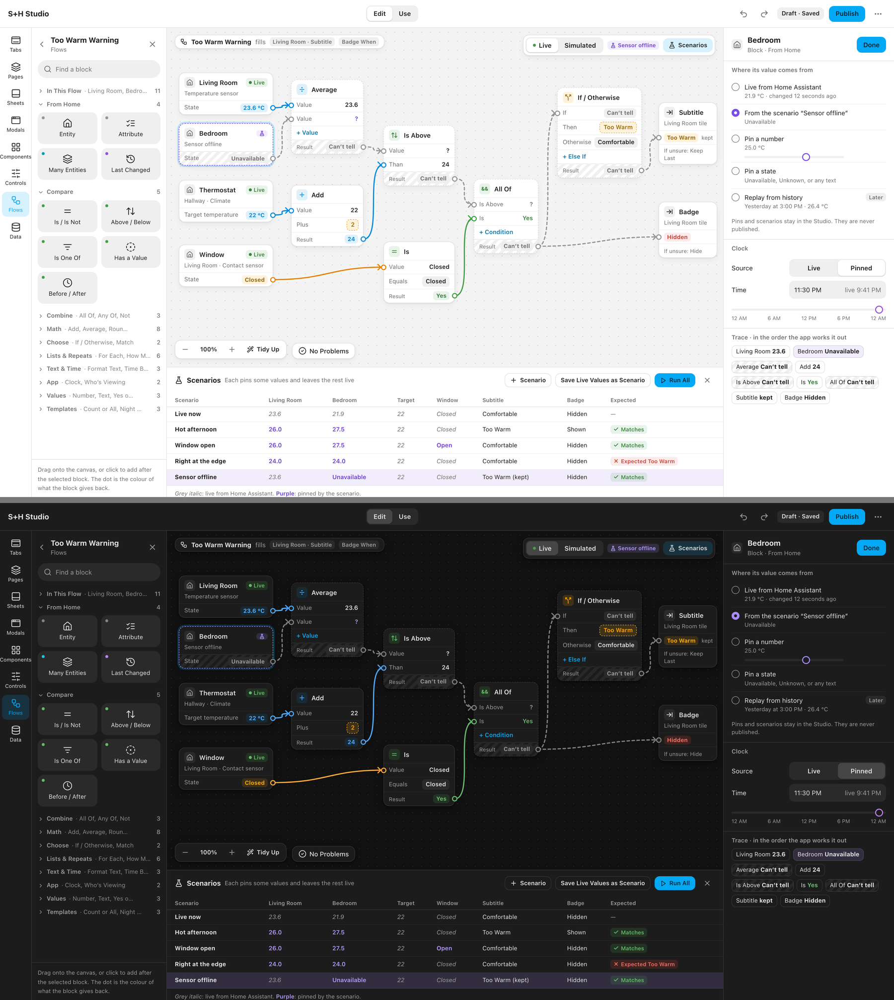
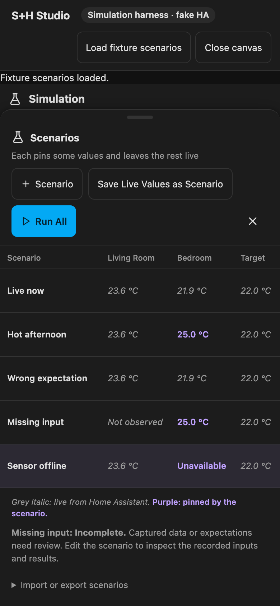
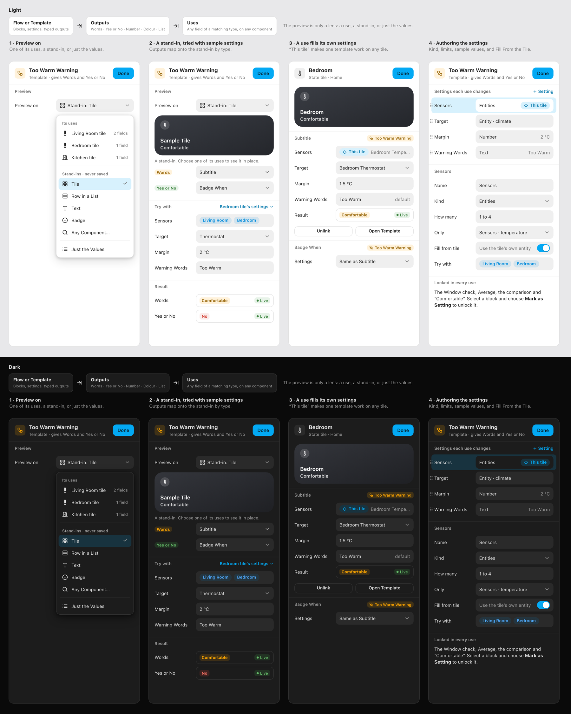
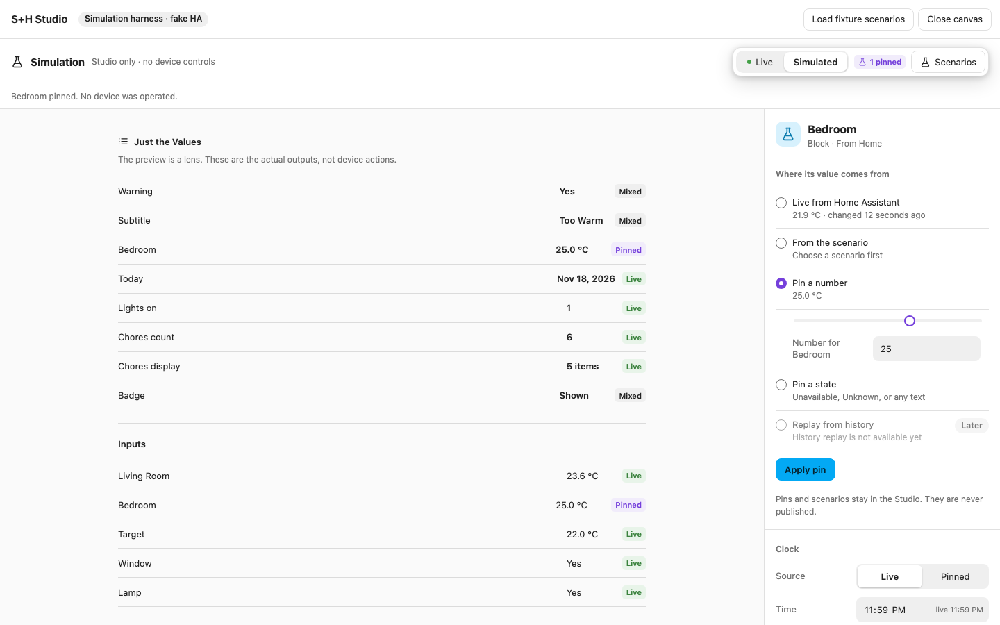
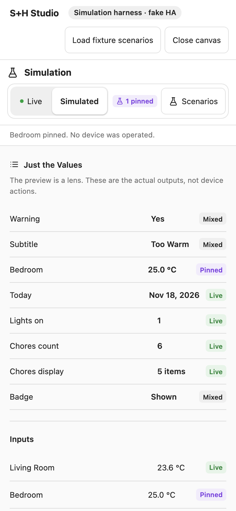

# W2-S simulation acceptance

This is Studio browser/harness evidence, not HA installation or native-device
delivery. Fixtures reuse the existing first-slice composition and demo house;
HA credential environment variables were cleared. All browser work used port
4823 and `test-results/studio-data/w2-s`, never the user's development data.

## Acceptance evidence

| ID | Evidence |
| --- | --- |
| S-live | `live.test.tsx`: identical requests grouped onto one existing live-run owner; request/parameter races, failed refresh with retained stale answer, steps-only changes, cancelled simulation debounce, entity/version updates without a new connection. |
| S-pins | `engine.test.ts`: bedroom 25 -> Too Warm -> Live 21.9; immutable capture/AST; typed computed/step overrides; dependency-specific modes; explicit per-source Live restoration; stale target refusal. |
| S-scenarios | Unit and desktop/phone Playwright: explicit Passed/Failed/Incomplete; offline Run All; review/save/reload; reopen Live; midnight edge; actual saved keep seed; tolerance; denied/quota/oversized storage; stale pins/semantic changes/truncated capture refusal. |
| S-trace | Actual shared-evaluator observations: raw count tests/viewer exclusion, filter reasons, sort positions, map/group values, numeric reducer membership, original pointers and real step budgets. Eight input chores become six after Keep Where; the separate display flow cuts six to five. |
| Observer invariants | Permanent `observation.test.ts` compares all 925 files in `contract/corpus/pipelines` and `contract/corpus/evaluation`: origin/main and branch, both with/without observer, byte-identical serialized evaluation results, step traces, errors/budget results and spend counts. Throwing diagnostic callbacks cannot change answers. |
| Network boundary | Desktop and phone intercepted traffic: one initial grouped safe flow read; zero extra fetches for pins, clock, drawers, Run All, capture or save; no device-write endpoint. Reload/reopen/Return to Live are distinguished from simulation. JSON records contain method/URL only, no headers or credentials. |

Focused commands and the W2-I mounting/lifecycle contract are in the
[host README](../../../src/workspace2/logic-simulation/README.md).

## No-observer benchmark

[`benchmark.json`](benchmark.json) records the full measurements against
origin/main `427eaba6236804275de58d3759c467f4bfcf3798`, Node v26.3.0 on this
shared macOS host. The flow has 64 entities and seven filter/map/group/count
steps. After 3,000 warm-up runs per implementation, 15 samples alternate
before/after order; each sample evaluates 3,000 flows. Answers and visit counts
are checked before timing.

| Unobserved implementation | Median per 3,000 runs | Approx. per flow |
| --- | ---: | ---: |
| origin/main | 523.126 ms | 174.375 us |
| W2-S | 525.844 ms | 175.281 us |

The measured median difference is **+0.52% (+0.91 us per 64-entity flow)**,
not a claim of literally zero timing overhead or a statistically isolated
hardware result. No diagnostic event objects/copies or observer-only item
loops are allocated/executed without an observer. Timing is reported, not used
as a flaky CI assertion.

## Recorded checks and artifacts

`npm test -- --maxWorkers=2`: 269 files, 12,183 passed and one existing skip.
`npm run build`: passed. Focused Playwright: six passed across desktop
(1440 x 900; design scene 1440 x 1100) and phone (390 x 844, 2x capture).
The permanent corpus comparison and observer invariants remain in those tests.
`npm run scan:house`: zero findings. Temporary browser servers were stopped.

- [Desktop pin traffic](desktop-pins-network.json),
  [phone pin traffic](phone-pins-network.json),
  [desktop scenario traffic](desktop-scenarios-network.json),
  [phone scenario traffic](phone-scenarios-network.json),
  [desktop design-scene traffic](desktop-design-network.json),
  [phone design-scene traffic](phone-design-network.json).
- [Actual drawer observations](drawers.json), generated from one shared-evaluator
  run of Sensor offline against the same fake fixture. Eight chores become
  six after Keep Where; First Few separately cuts six to five. These are actual
  observations, not reconstructed drawer evidence.

## Design comparison

Read and compared the actual approved
[`13-sim.png`](../../design/flows/13-sim.png) light/dark reference and
[`14-preview.png`](../../design/flows/14-preview.png) preview/lens reference,
linked from the binding [flows contract](../../flows-canvas.md).
The previous browser-default screenshots have been replaced, not retained as
current evidence. Each capture below is next to its reference. Click for full
resolution; the simulation reference contains both light and dark scenes.

| Scene | Approved reference | Revised capture |
| --- | --- | --- |
| Sensor offline, desktop light |  |  |
| Sensor offline, desktop dark |  |  |
| Inspector and full trace, desktop light |  |  |
| Inspector and full trace, desktop dark |  |  |
| Scenarios bottom sheet, phone light |  |  |
| Scenarios bottom sheet, phone dark |  |  |
| Source bottom sheet, phone light |  |  |
| Source bottom sheet, phone dark |  |  |
| Pin 25, Too Warm, desktop |  |  |
| Pin 25, Too Warm, phone |  |  |
| Live 21.9 restored, desktop |  |  |
| Live 21.9 restored, phone |  |  |
| Saved cases after reload, desktop |  |  |
| Saved cases after reload, phone |  |  |

### Intentional deviations and reasons

- The main surface is **Just the Values**, not a counterfeit canvas. W2-C owns
  blocks, port values, hatching, wires and kept badges; no canvas file changed.
  The block/port observation API is documented in the
  [mounting/observation seam](../../../src/workspace2/logic-simulation/README.md).
- The harness is visibly labelled fake HA, not the integrated workspace.
  It loads the real Studio theme, segmented controls, fields, buttons, tags
  and sheet primitives. The reference's purple pin semantic has no existing
  Studio theme token, so a single scoped light/dark purple token was added.
- The authored fixture uses the approved native Add/Divide average recipe,
  so the trace includes its real Add and If/Otherwise results instead of
  concealing them or inventing a native Aggregate block. Subtitle kept is
  proved by the real text-slot result and saved keep seed. Badge Hidden is
  an authored fixture expression, not a simulated native badge consumer.
- Numeric/state edits keep an explicit **Apply pin** action so incomplete or
  invalid field edits cannot silently become overlays. Typed computed/stream
  pins and explicit JSON import/export remain available in styled disclosures.
- The clock includes the requested normal date picker. The fake live clock is
  11:59 PM UTC for the midnight acceptance edge, rather than the illustration's
  9:41 PM; Sensor offline pins 11:30 PM. Its zone is stated. DST gaps are
  rejected locally and no offset input or clock lookup request is exposed.
- Scenario values are **live at capture**, not falsely labelled fresh HA
  readings during an offline replay. Their neutral Live tags and explanation
  distinguish them from purple overlays. While a saved case is selected,
  unobserved Live-row outputs say Not run: the table does not cause a hidden
  extra evaluation. Run All still compares every output, including outputs
  outside the focused Subtitle/Badge table lens.
- The cases include a deliberate wrong expectation and a missing-input case,
  retaining explicit red failure and neutral Incomplete evidence. On phones
  the table scrolls internally with a sticky name column; source/clock/trace
  content scrolls within the inspector sheet rather than being squeezed.

The final reservation check used origin/main
`427eaba6236804275de58d3759c467f4bfcf3798` and fetched all open heads:
#27 `f069fe5b0af48092722d9d7eb2f8506d77e8c534` (26 paths),
#28 `7c634668b4d55831e3e81ccb933151537bf33907` (8 paths), and
#29 `196cac8653b0b9e910f5bc3fedd3b5829510eba7` (62 paths).
The full diff-derived reservation sets had zero intersections with this lane.

The pre-revision CI e2e shard 6 failed during **browser dependency installation**,
before any tests: the Ubuntu 26.04 runner could not locate its font packages
([job log](https://github.com/SFenton/ha-native-home-app/actions/runs/44490049920/job/135443080632)).
That workflow/runner configuration is outside W2-S ownership. The isolated
local desktop/phone run above completed; it is not represented as a passing
remote CI run.

## Scope and limitations

The host is not yet integrated into the production workspace; W2-I owns that
integration. Existing connection freshness must be supplied by its owner.
Deactivation must render once before unmount to cancel the shared live-run
hook's existing timer. No changes were made to graph core, compiler forwarding,
schema, server, workspace shell, iOS or Core integration. Browser geometry and
the fake data are not evidence of physical hardware behavior.
