# W2-C: revised canvas design evidence

The reference images in [the binding contract](../../flows-canvas.md) were read
at their original aspect ratios. The revision replaces the initial draft's
expanded, generic-glyph palette, technical port rows, instruction banner and
always-visible accounting panel. Optional observation rendering follows 13-sim;
the ordinary harness now deliberately shows no port values at all.
Interaction and keyboard coverage remain intact.
This is the isolated CanvasHost harness, not shell integration or an iOS client.

## Reproduce and results

```sh
npm test
npm run build
STUDIO_E2E_PORT=4822 STUDIO_E2E_DATA_DIR=./test-results/studio-data/w2-c \
  npx playwright test tests/e2e/workspace2-flows-canvas.spec.ts \
  --config tests/flows-canvas/canvas/playwright.config.ts
# The standard CI config must run these too, without skips:
STUDIO_E2E_PORT=4822 STUDIO_E2E_DATA_DIR=./test-results/studio-data/w2-c \
  npx playwright test tests/e2e/workspace2-flows-canvas.spec.ts
npx vitest run tests/flows-canvas/graph/canvas-performance.test.ts \
  --maxWorkers=2 --reporter=verbose --silent=false
```

## Single-walk batch sealing (latest)

The [hosted `7c39257` compiler job](https://github.com/SFenton/ha-native-home-app/actions/runs/44545047545/job/135633253681)
failed at **55.13 ms**: validate **33.94**, lower **22.48**, adapter **14.98**,
indexes **2.67 ms**. Initial construction was **141.87 ms**, outside that timer.
All stages rose by roughly the same factor versus the accepted `9593927`
baseline; this does not establish a 19 ms descriptor-check cost.

New data now has one post-freeze prototype/key/descriptor walk, which also
enqueues children. A batch shares one private proof and `WeakSet`, instead of
allocating/freezing a proof per object. Existing factory construction boundaries
mark immutable data before exposure and keep O(1) reuse. No unchecked factory
marker, module-level mutable registry, cached validation or compilation was added.
All rejection cases remain; two additional cases prevent accessor/function data
at the reserved seal key from being overwritten before rejection.

Adjacent isolated runs on **Node 22.23.5**, same Mac, fixture, compiler options,
warmups and gate:

| Metric | Committed `7c39257` | Correction |
| --- | ---: | ---: |
| Total sealing per new data object | 856.02 ns | 603.34 ns |
| Observed validate+lower median | 16.37 ms | 16.62 ms |
| Initial / edited construction | 40.76 / 0.83 ms | 31.65 / 0.73 ms |
| O(1) seal check | 26.65 ns/call | 31.93 ns/call |

Sealing is **29.5% cheaper per new object**; the compiler result is essentially
flat, not evidence of recovering the hosted target. The construction profile
includes checks, freezing and proof insertion over **47,543 new objects** per
fixture, nine samples after three warmups; lifting/counting are excluded.
The baseline loads only the committed `validate.ts` through a temporary
load-only Vite plugin; all other source, config and the test are identical.
The checkout is never switched or modified for comparison.

Compiler sampling remains 31 runs after 30 warmups, fresh indexes, accounting
enabled, one native compile and the unchanged **50 ms** assertion. The separate
probe records **zero construction key walks** on revision/node/edge containers
for **both versions**. Thus repeated full sealing is not inside that timer;
the hosted excess cannot be assigned quantitatively to it from these runs.
After-stage medians: validate **10.19**, lower **6.44**, adapter **4.36**,
indexes **0.89 ms**. Adapter/index costs are included in lower/validate;
independent medians are not additive. Trusted handoff read: **29.24 ns/call**.

`npm test` on Node 22 passed **280 files / 14,428 tests**, one existing skip;
the full-suite compiler median was **25.32 ms**. Build/typecheck and all **30**
standard-config browser cases passed, preserving byte goldens and #24.
Desktop mount/focus/edit: **1,119.42 / 90.29 / 155.28 ms**; phone:
**1,080.61 / 130.40 / 185.74 ms**. Raw JSONs are refreshed; screenshot noise
is not included. Temporary servers stopped; user development data was untouched.

The new hosted **about-36-ms-or-below** target remains to be verified by the
orchestrator after the push. These local runs are not a hosted performance claim.

## Round-four plain-data construction boundary (prior head `7c39257`)

The accessor probe now fails explicitly at construction, before a trusted
handoff can be issued. Newly encountered objects must have only own data
properties, no functions, and a prototype of `Object.prototype`,
`Array.prototype` or `null`. Unsupported input throws `TypeError`, rather than
evaluating getters or silently repairing data. Array-index, non-enumerable and
symbol-keyed accessors are covered. Failed input may be partially frozen and
must be discarded.

Node's capability-detected `util.types.isProxy` rejects detectable proxies
before their reflection traps run. Browsers have no reliable general proxy
detector: each new object is therefore frozen before its child descriptors
are read for traversal, and its own data/prototype constraints are checked
again. The browser regression swaps in a fresh endpoint during a proxy's
`preventExtensions` trap; that endpoint is also frozen, cannot subsequently
change its port, and gives identical fresh/trusted lowering. Sealed data still
takes only its O(1) check, with no repeated traversal or freezing.

The reviewer's **prior-head `9593927`** hosted result is **36.35 ms** compiler
median (validate 21.70, lower 14.55, adapter 9.86 ms), accepted by the owner;
the original 50 ms gate is unchanged. Its desktop/phone mounts were
**1,918.64 / 1,520.99 ms**, and all twelve checks passed. These are baseline
figures, not measurements of this correction. The subsequent `7c39257` compiler
failure and its follow-up are recorded above.

Local verification of the correction:

- `npm test`: **280 files / 14,426 tests passed**, one pre-existing skip;
  unchanged corpus byte hashes and #24 differential passed. Production build
  and typecheck passed.
- All **30 standard-config desktop/phone browser cases passed**, including the
  freeze-time proxy regression, keyboard editing and complete off-screen/Outline
  reachability. Desktop mount/focus/edit: **1,119.47 / 90.14 / 155.25 ms**.
  Phone: **1,064.65 / 127.62 / 185.11 ms**. Mount port reads: **99 / 96**;
  edit geometry reads: **zero**. Raw timing JSONs are refreshed.
- Final isolated observed compiler median: **15.24 ms**, with validate **9.70**,
  lower **5.47**, adapter **3.31** and indexes **0.91 ms**; **34.76 ms** under the
  unchanged 50 ms gate. Adapter/index timings are included in lower/validate,
  respectively; independent medians are not additive. The unrestricted full
  suite's compiler median was **21.76 ms**.
- The isolated O(1) construction-seal check costs **25.51 ns/call**; the trusted
  handoff read costs **29.50 ns/call**, each over one million calls after 10,000
  warmups. No graph traversal or freezing occurs on these paths. Initial/edit
  construction was **45.47 / 0.90 ms**; descriptor checks happen at construction,
  not per lowering call, and remain included in end-to-end browser mount/edit.
- Paired observed lower was **6.08 ms** versus unobserved **7.06 ms**, with median
  paired net cost **-1.46 ms** over 51 alternating pairs after 30 paired warmups.
  This includes capture/reduction and the avoided legacy scope-locator walk;
  it is not an isolated callback-dispatch measurement.

## Single-pass compiler accounting

Merged main at `897268f` (#28). The production `FlowCanvas` now opts into the
existing compiler pass's accounting observer; snapshots travel through
`graph/compile.ts` and `FragmentCompilation` to the budget reducer. There is no
second compile or counting walk. Unobserved public callers remain compatible.
Five corpus documents match native Checker counts exactly; focused tests also
cover the 17-case refusal, shared-call 129, partial malformed input, flow-input
pointer rebasing and a shared call counter enclosing the edited field.

The refreshed [desktop meter](desktop-meter.png) and
[phone meter](phone-meter.png) now come from the actual canvas, not an injected
budget fixture. The [desktop refusal](desktop-meter-refusal.png) and
[phone refusal](phone-meter-refusal.png) show the compiler's 17-of-16 choice limit.
Partial refusals display their actual size and minimum/maximum, marked partial;
their missing traversal totals are never invented.

The unchanged 50 ms performance assertion now exercises the observed path on
the same 2,341-node / 32-step edited fixture, with fresh indexes, 30 instrumented
warmups, 31 samples and exactly one native checker call per sample. A separate
paired measurement includes capture and reduction in the observed lower cost.
Hosted targets remain <=35 ms compiler and <=2,500 ms mount per device; the
orchestrator owns hosted verification after the push.

Local accounting acceptance:

- Unrestricted `npm test`: **280 files / 14,414 passed**, one pre-existing skip.
  The observed compiler median was **19.59 ms**: validate **12.21 ms**, lower
  **6.54 ms**, adapter **3.74 ms** (included in lower). Fresh indexes **1.36 ms**.
  This leaves **30.41 ms** under the unchanged 50 ms gate locally.
- Final isolated gate: **16.48 ms** total; validate **9.56 ms**, lower **6.80 ms**,
  adapter **3.69 ms**, indexes **1.05 ms**. Stage medians are independent.
- Isolated matched accounting profile: observed lower **6.31 ms**, unobserved
  lower **7.44 ms**, paired net cost **-1.61 ms**, over 51 alternating pairs after 30
  paired warmups. This includes snapshot capture and meter reduction, not just
  callback dispatch. The observed reducer replaces the unobserved fallback's
  scope-location AST walk, so net cost is not isolated observer-callback cost.
- A prior concurrent full-suite/build run failed at **51.10 ms**. The unchanged
  code passed at 28.11 ms with no concurrent build/browser work of ours, and the
  final suite passed at 19.59 ms; that
  failure is not counted as a pass or an exact causal measurement of Mac load.
- All **28 standard-config browser cases passed**. Desktop mount/focus/edit:
  **1,084.81 / 90.81 / 157.72 ms**; phone **1,117.43 / 135.64 / 189.66 ms**.
  Both are below the local mount target; neither is hosted CI evidence.
  Mount port reads remain **99 / 96**, with **zero** edit geometry reads.
- Partial guard tests include zero limits and exclusive-boundary refusals:
  these show the authoritative refused size, not a fabricated percentage.
- Production build/typecheck passed. The original corpus golden file and
  permanent #24 differential were not changed and pass.

## Earlier construction evidence

Construction-time immutability correction (supersedes repeated deep freezing):

- The `2f6be72` hosted compiler gate failed at **70.80 ms**: validate **48.82 ms**,
  validated lower **24.81 ms**, adapter **11.53 ms**, indexes/freezing **18.58 ms**.
  The increase is not a measured 39 ms handoff lookup: preparation and the other
  stages all slowed down; stage medians are independent and not additive.
- Canvas initialization and successful edits now call `constructGraphRevision`.
  New objects are frozen once and hold private, exact-object, non-enumerable
  construction seals. Old sealed nodes/payloads are reused without traversal.
  No mutable module registry or validation/compilation cache is used.
- Focused local compiler run: **16.91 ms** total; validate **10.22 ms**,
  lower **6.60 ms**, adapter **3.29 ms**, fresh indexes **0.99 ms**.
  Construction was **16.73 ms** initially and **0.62 ms** for the edited revision.
  Isolated trusted-handoff reads averaged **27.26 ns/call**; construction-seal
  checks **24.52 ns/call**, each over one million reads after 10,000 warmups.
- Unrestricted `npm test` passed **278 files / 14,169 tests**, one pre-existing skip.
  Compiler median **30.40 ms** (19.40–77.40); validate **21.03 ms**, lower
  **7.14 ms**, adapter **3.50 ms**, indexes **1.31 ms**. Under concurrent suite
  load construction was **99.32 ms** initially and **1.20 ms** for the edit.
  Build/typecheck passed.
- Construction is explicitly separated from compiler timing, not silently moved
  out of an unchanged API: compiler calls reuse constructed immutable data, while
  browser mount/edit still include construction end to end. The fixture, 30
  warmups, 31 samples, one-native-compile assertion and 50 ms gate are unchanged.
  Existing edge/node/literal mutation tests and all corpus/#24 comparisons pass.
  New tests cover no retraversal/refreezing, seal forgery and non-extensible input.
- All **26 standard-config local browser cases pass**. Desktop mount/focus/edit:
  **1,223.98 / 88.34 / 169.71 ms**; phone **1,115.66 / 132.71 / 204.49 ms**.
  Mount port reads stay **99 / 96**, and edit geometry reads stay **zero**.
- Completed hosted browsers at the **prior head `2f6be72`** passed all eight
  shards, including all 26 canvas cases. Desktop mount/focus/edit was
  **1,898.65 / 252.59 / 287.96 ms**; phone **1,462.08 / 164.81 / 517.94 ms**.
  Both mount targets passed, but that head's compiler failed at 70.80 ms, so its
  CI is not green. The new construction revision needs its own hosted evidence.

Earlier round-three local results at `2f6be72`:

- Full suite: **278 files, 14,164 passing tests**, one pre-existing skip.
- Production build and TypeScript: **passed**.
- Isolated Playwright: **26 passed**, thirteen desktop and thirteen phone.
- Standard CI Playwright config: **26 passed, none skipped**, using the same
  4822/data overrides. The harness HTML swap is test-owned; no shell/server or
  workflow change is needed.
- **2,341 nodes / 32 steps:** validate plus already-validated lower median
  **26.69 ms**, minimum 24.32, maximum 38.46; 31 samples after 30 instrumented warmups.
  Stage medians: **validate 18.01 ms; lower 8.46 ms; adapter 3.77 ms**.
  Lower includes the adapter; medians are independent and are not additive.
  Exactly one native source compile is asserted per sample, with the original
  **<=50 ms** gate unchanged.
  Deep-freezing and index construction cost **7.32 ms** and are included, not moved outside
  the timed validation/total. The identical immutable fixture is used every run;
  warmups include the adapter/native-checker spies, and their records are cleared
  before collecting the 31 measured samples.
  This full suite used `npm test -- --maxWorkers=2` because the shared Mac was
  concurrently running other CPU-intensive tasks. Earlier runs saw a 53.79 ms
  median failure and a separate 5 s total-test timeout (41.65 ms median);
  neither is counted as a pass. The final focused run passed at 46.13 ms.
  The test's overall watchdog is now 30 s so 61 instrumented iterations plus
  lifting/profiling can finish under contention; the 50 ms performance assertion
  and every browser budget are unchanged.

The review baseline was **11,570 ms lookup**, **42,810 ms Chromium mount** and a
focus timeout. The round-three local isolated browser measurements are:

| 2,341-node fixture | Desktop | Phone | Asserted budget |
| --- | ---: | ---: | ---: |
| Mount, navigation through two painted frames | 1,206.01 ms | 1,140.51 ms | <5,000 ms |
| Freeze/build index and resolve every incoming port | 8.80 ms | 9.10 ms | <50 ms |
| Select a Number and focus its output | 107.33 ms | 133.49 ms | <1,000 ms |
| Submit a valid literal edit through two painted frames | 172.60 ms | 202.58 ms | <1,500 ms |

Raw browser measurements are in [desktop](desktop-large-performance.json) and
[phone](phone-large-performance.json), and attached to the browser test report.
These are real browser interactions on the complete fixture, not a smaller
proxy or a disconnected edit that avoids compilation. These are standard-config
measurements; the dedicated config also passed all 26 cases. All 2,341 blocks remain
in the graph; only visual cards/ports and nearby wires are windowed. Lightweight
headers retain complete assistive-technology order and list position metadata.
Off-screen DOM focus and Home/End reveal and scroll their target, and Outline
still exposes all 2,341 full blocks and 2,340 connections.

The pre-windowing local mount profile made **9,360 port reads** on each device,
with scripting **1.181 / 1.181 s** and style recalculation **0.139 / 0.139 s**.
Windowed profiles made **99 / 96 port reads**, with scripting **0.655 / 0.632 s**
and style recalculation **0.018 / 0.014 s**. Chromium's total-node metric fell
from **321,598 / 316,420** to **38,056 / 31,442** (including detached nodes).
The regression asserts fewer than 100 visual cards and 500 mount port reads,
without changing the original timing gates. The hosted mount target is <=2,500 ms;
current-head hosted results are recorded in the PR body.
The literal-edit regression additionally asserts **zero port/board geometry
reads**. Stable block presentation models, actions and memoized wires avoid
graph-wide React rendering; only affected models change. Actual topology,
position or displayed-label changes still invalidate wire geometry.

The round-two hosted baseline at `57919bd` was 1,574.51 ms desktop edit and
1,620.72 ms phone edit, failing the unchanged 1,500 ms gate. Its accepted mount
times were 3,103.63 / 3,296.00 ms and focus was 691.03 / 775.40 ms.
Current-head hosted timings and complete CI status are recorded in the PR body.
The completed `613f824` hosted browser shards passed all 24 canvas cases:
desktop mount/focus/edit **3,038.33 / 682.70 / 885.28 ms**, phone
**2,878.46 / 648.64 / 814.83 ms**, with zero edit geometry reads.
Its compiler gate failed at **50.314 ms**; it is not presented as green CI.

The validator body did not change between `57919bd` and `613f824`; only the
opaque handoff wrapper changed. Local profiling found the trusted read to be
nanoseconds, not the hosted validation increase of 8.37 ms. No historical hosted
CPU profile exists to attribute that increase more precisely. Warmed CPU profiles
identified JSON bounds walks, grammar descriptors, original/binding lookup,
projection allocation and garbage collection as the real compiler work.
The headroom revision shares indexes through validation and lowering, avoids
eager diagnostic-origin maps and single-port sets, uses authoritative expression
descriptors directly for math/item nodes, reuses binding maps for unbound equality,
and replaces projection entry/map/fromEntries chains with ordered loops.

Local validate-plus-lower was 31.76 ms in the independent review and 29.18 ms
in the preceding observation revision. The hosted pre-fix baseline at
`79e14a7` was **97.72 ms** (60.69 minimum, 151.42 maximum). Current hosted stage
figures and actual run-not-skipped log evidence belong to
[PR #29's verification record](https://github.com/SFenton/ha-native-home-app/pull/29):
local figures do not prove the hosted runner meets the unchanged gate.

Every unobserved corpus case and both the original and edited large fixture match
pre-optimization golden ordered-tree hashes captured at `196cac8`.
The hashes cover ordered diagnostic codes/paths/messages and every lowering
output field; repeated whole-document anchor strings are hashed without
materializing a >512 MB serialization. The permanent seeded #24 differential
test remains unchanged and passes. Direct unvalidated `lower` still rejects
invalid graphs; the explicit handoff is separately compared with it.
The token now uses frozen instances with runtime-checked private fields, not
copyable public trusted data. Spread copies, re-wrapped graphs, swapped
diagnostics, prototype impostors and proxies are rejected. The exact graph keys a
private per-token WeakMap; trusted reads do not compare or hash graph contents.
Core indexes are per call or immutable editor revision and shared with projection,
with no cross-call caches or mutable module state.
Preparation now also deeply freezes the exact graph and nested data. Edge/node
array edits, edge endpoints, input arrays and nested literal changes are refused
at runtime; tests include an already shallow-frozen outer graph. No shallow
`Object.isFrozen` shortcut or cross-call freeze registry is used. Standalone
diagnostic-only `validateGraph` remains non-freezing, preserving #24's same-object
mutation regression; trusted preparation and direct lower freeze before indexing.

The dedicated configuration defaults to 4822 and honors the port/data overrides.
It has no HA/persistence backend or credentials. The standard configuration uses
its isolated test backend, never development data. Playwright stops both temporary
servers. Browser screenshots use desktop
1440 x 900 and touch-enabled phone 390 x 844; the complete desktop Too Warm
scene and desktop observation scenes use 1920 x 1120. Phone PNGs retain their
2x pixel density.

## Side-by-side reference comparison

Each curated screenshot is paired with its unmodified approved reference.
Open the images for full-size comparison; aspect ratios are not changed.
The compound summary follows panel 3 of 15-editor, **not superseded panel 2**.

| Curated screenshot | Approved design reference |
| --- | --- |
| **Desktop, light palette** 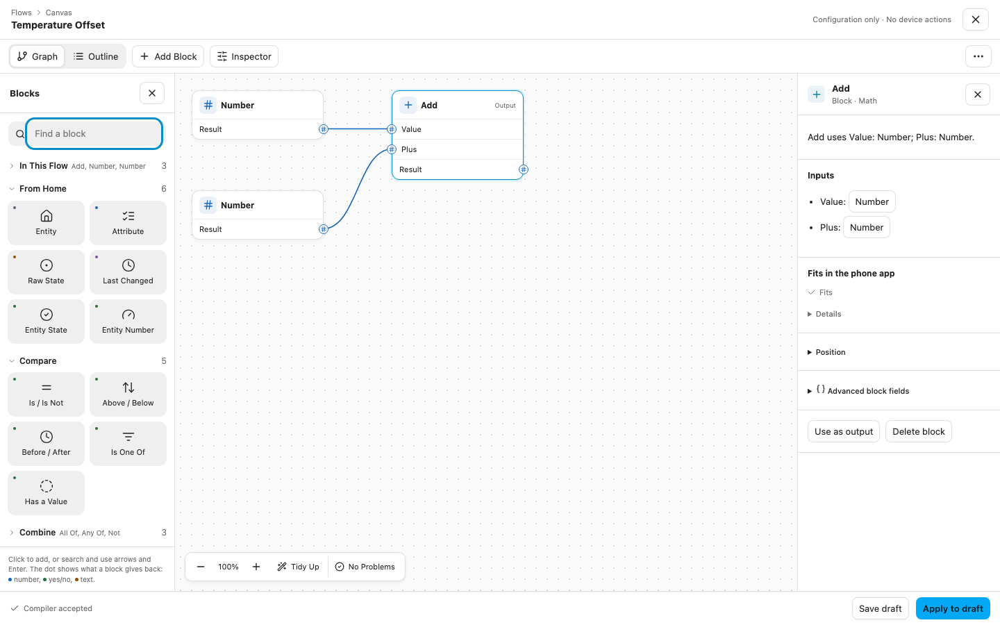 |  |
| **Desktop, dark palette**  |  |
| **Desktop, custom HA palette** 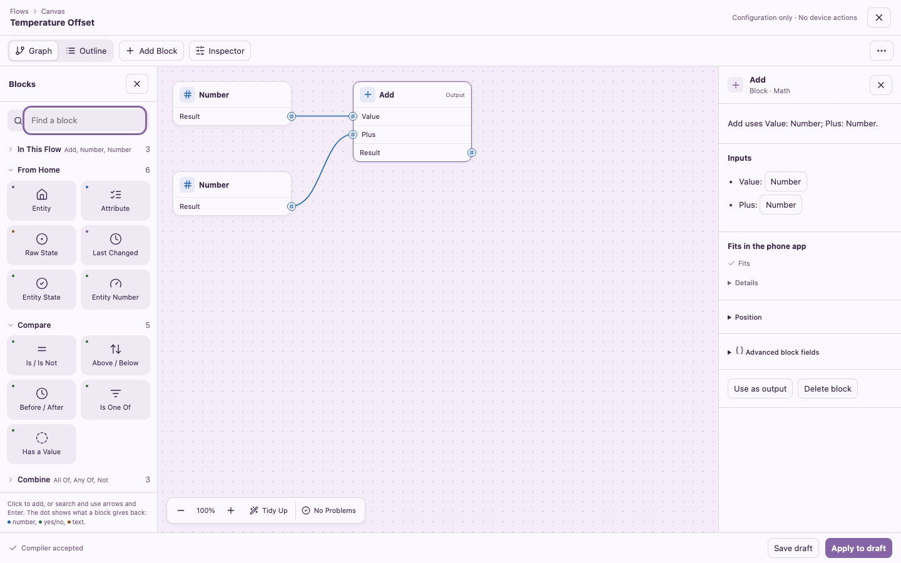 |  |
| **Phone, light palette sheet**  |  |
| **Phone, dark palette sheet**  |  |
| **Phone, custom HA palette sheet**  |  |
| **Desktop, light canvas**  |  |
| **Desktop, dark canvas** 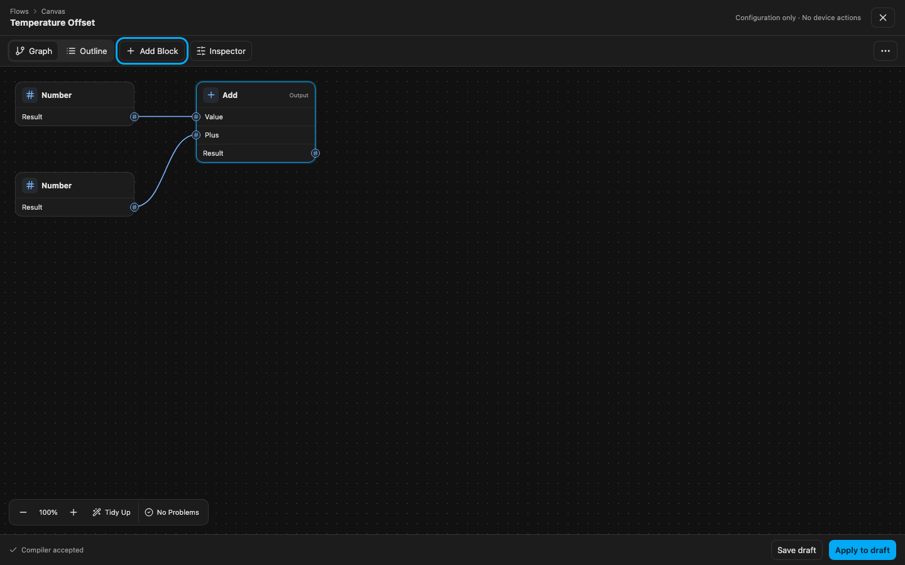 |  |
| **Desktop, custom HA canvas** 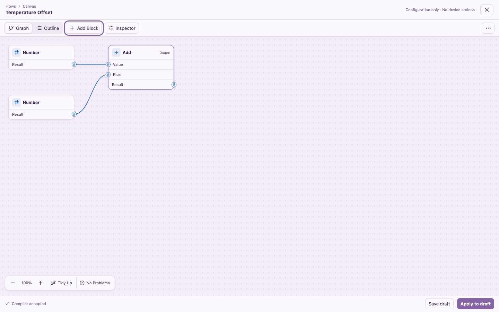 |  |
| **Phone, light canvas**  |  |
| **Phone, dark canvas**  |  |
| **Phone, custom HA canvas**  |  |
| **Desktop, light summary**  | 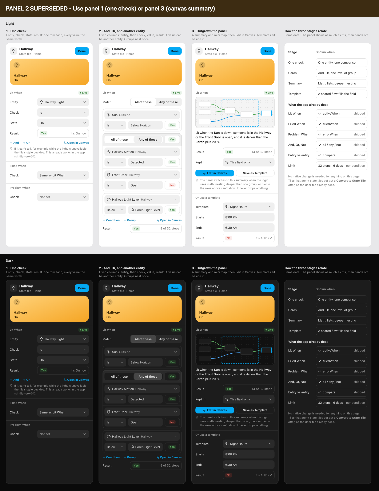 |
| **Desktop, dark summary**  |  |
| **Desktop, custom HA summary**  |  |
| **Phone, light inspector sheet** 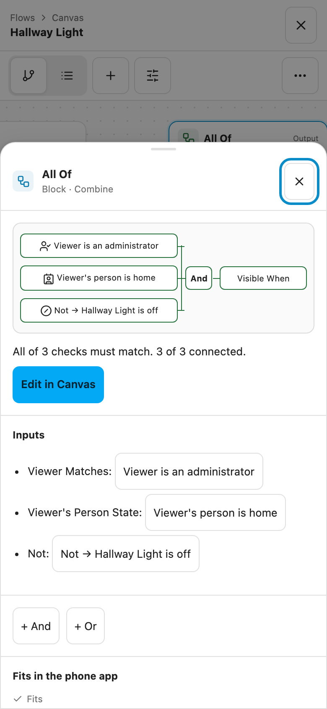 |  |
| **Phone, dark inspector sheet** 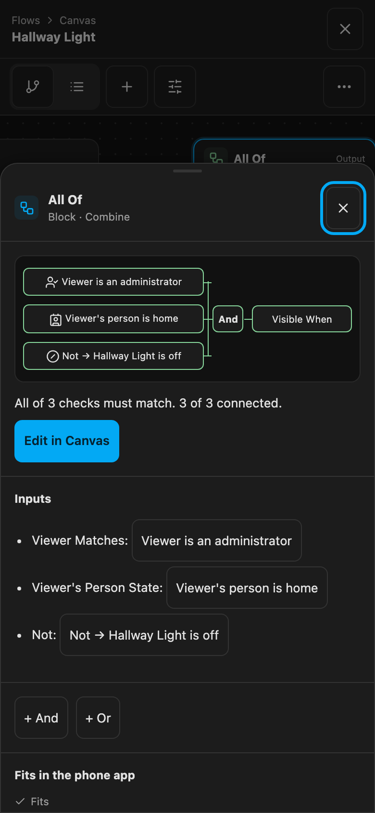 |  |
| **Phone, custom HA inspector sheet** 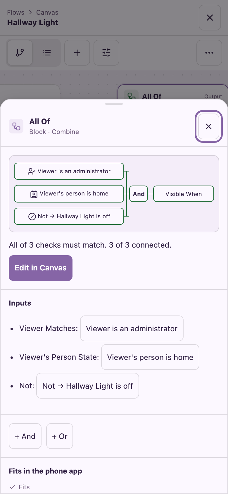 |  |
| **Desktop, above-threshold inspector meter** 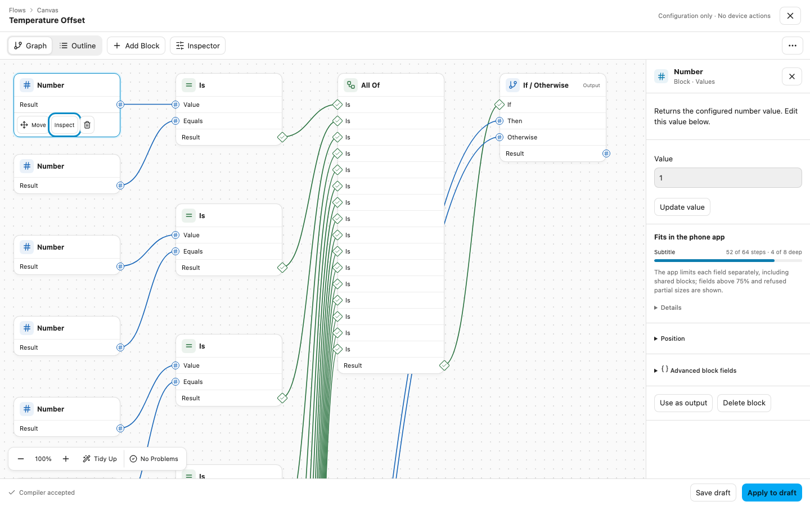 |  |
| **Phone, above-threshold inspector meter** 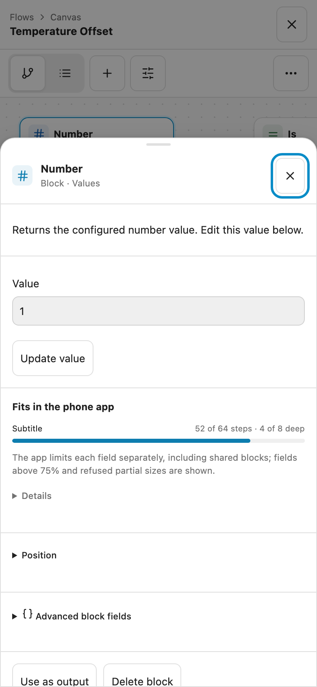 |  |
| **Desktop, refused 17-case rule** 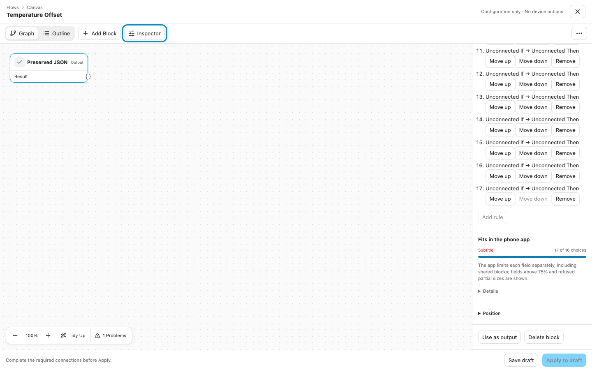 |  |
| **Phone, refused 17-case rule** 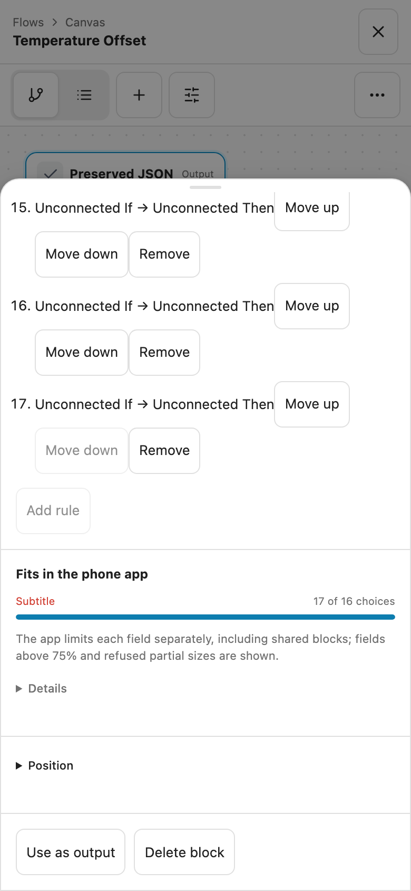 |  |
| **Too Warm Warning: Average, Is Above, All Of, If / Otherwise**  |  |
| **Too Warm Warning: phone selection lens**  |  |
| **Desktop, light observations**  |  |
| **Desktop, dark observations** 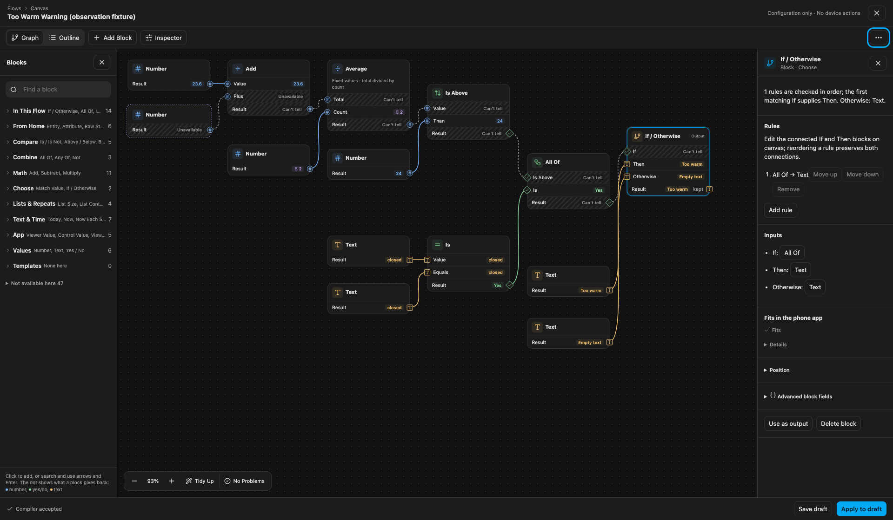 |  |
| **Desktop, custom HA observations** 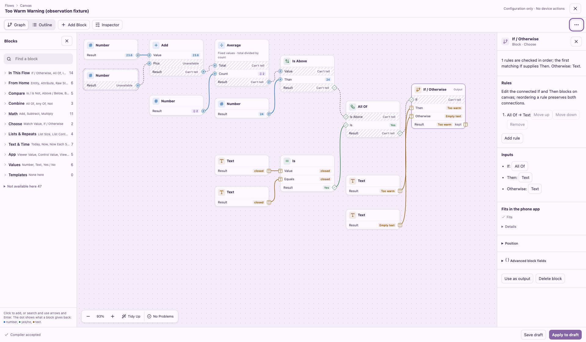 |  |
| **Phone, light unknown/kept output** 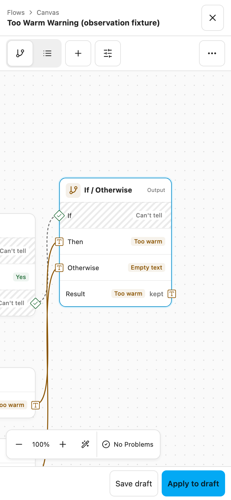 |  |
| **Phone, dark unknown/kept output**  |  |
| **Phone, custom HA unknown/kept output**  |  |
| **Phone, light scenario-unavailable source**  |  |
| **Phone, dark scenario-unavailable source**  |  |
| **Phone, custom HA scenario-unavailable source**  |  |
| **Phone, light pinned source** 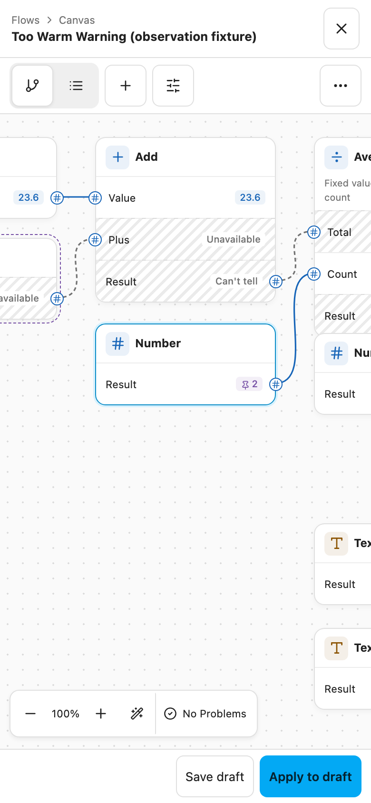 |  |
| **Phone, dark pinned source** 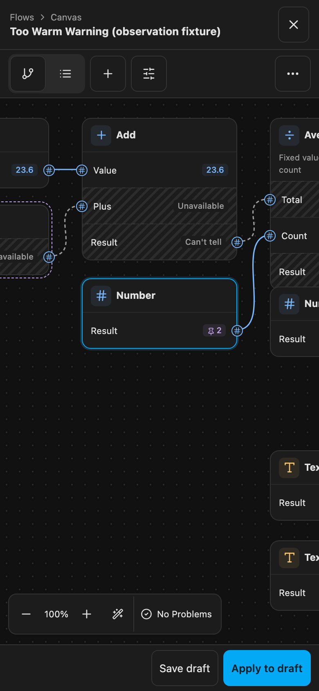 |  |
| **Phone, custom HA pinned source** 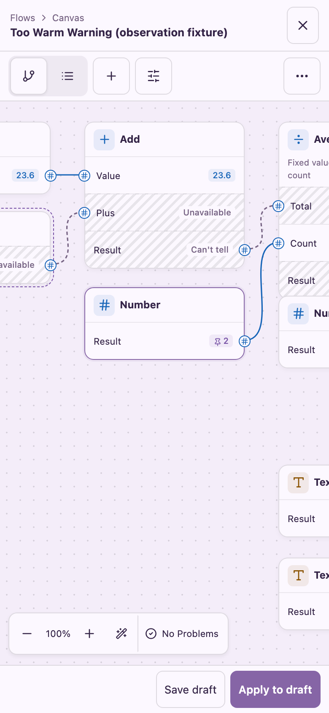 |  |

## Fidelity and intentional deviations

| Area | Result / intentional deviation and reason |
| --- | --- |
| Palette | Components-like two-column chips with distinct block icons, result dots and a footer legend. All eleven categories start collapsed, with counts and name previews; screenshots deliberately expand From Home and Compare and leave keyboard focus on Search. Its ring is checked against the actual field and panel surfaces, as well as derived hover/selected/canvas surfaces, in every theme. Unavailable entries appear only in one closed disclosure. |
| Native variants | Is / Is Not, Above / Below and Before / After share default chips, with every operation retained in the inspector and searchable individually. Native entity-state and numeric checks remain available in From Home, so counts differ from the illustration. Many Entities is inside Not available here for this document-field scope, rather than pretending a flow request is a scalar block. |
| Ports and wires | Human labels and blue/green/orange type colors replace raw operation/type subtitles. Hash/circle, T/square, check/diamond and distinct time/entity/record glyphs add non-color type encodings; lists use doubled lines with their declared item glyph (unknown for mixed/unresolved items). Ordinary screenshots have no port values, including literals. Only the optional, explicitly supplied observation fixture adds values, purple pins, unknown hatching/dashed wires, kept outputs and scenario outlines. Shape/compatibility still come from the graph core, not observations. |
| Too Warm fixture | Same warning scene and four requested operator families, with authored literals 23.6, 25, threshold 24 and closed-state text. Without observations these settings are visible only when edited, not as invented live port readings. The approved fixed Average recipe remains expanded as Add / Divide / count, with an Average label only for that exact recipe; explicit literal cards remain editable. This accounts for more cards than the illustration, without introducing the rejected aggregate opcode. |
| Observation fixture | Separate scripted per-port readings reproduce the offline/unknown/pinned/kept states from 13-sim without evaluating anything. The host explicitly marks the retained warning output; the canvas does not infer retention. Direct scenario pins have a purple dashed outline, and unknown outputs have grey dashed wires. Scenario controls, clock, drawers and live provenance editing remain W2-S's; output-destination adapters remain W2-I's. No claim is made that authored literals are home entities or that fixture readings came from HA. |
| Inspector | And / Or use the actual connected branch count, configured entity/check labels, connected mini-map and friendly output destination, with Edit in Canvas. The refreshed fixture has three distinct branches: administrator, person at home, and Not → Hallway Light is off. Not remains an explicit, non-reversing group and no longer duplicates the administrator branch. The fixture declares the native compiler's supported capabilities and asserts No Problems. Other descriptions use the selected field's configuration and connections. No condition-card editor is added. Simulation controls, real previews and additional output lenses belong to other lanes and are intentionally absent. |
| Chrome | Quiet compact zoom / Tidy Up / problems bar; fit, pan, undo/redo and keyboard help moved into overflow. Connections live in Outline. The harness keeps its own title, Close, Save and Apply controls instead of copying the workspace's Publish chrome: shell integration belongs to W2-I, and Apply must not imply Publish. |
| Phone | Single-row toolbars and modal bottom sheets reuse Base UI. Full-size selected cards can be panned rather than shrinking an entire graph to illegible text. Touch targets retain 44 CSS pixels. This is a browser adaptation of the desktop reference, not native hardware validation. |
| Meter | One field row with a thin bar, steps/deep wording and one sentence; every technical detail is behind closed Details. The illustration's 23/64 example is below its own 75% rule, so evidence instead uses the checker's real **52/64, depth 4/8** fixture. The fixture labels its origin and renders the real Inspector; it does not inject production counters. |
| Custom theme | Lavender HA tokens intentionally replace the reference's neutral grounds. Contrast-adjusted socket/focus colors retain their type meaning in light, dark and custom themes. |

## Accounting correctness and remaining dependency

The observation seam is documented in the [host handoff](../../../src/workspace2/canvas/README.md#optional-observation-input).
PR #30 merged as `1ae7d5f`; main is merged into this branch. Its
`canvasObservations` function and `CanvasObservations` type are exported from
`workspace2/logic-simulation`, not `shared/composition/graph-observation`.
The shared module exports the run-observation collector, `createObservation`.
The simulation display DTO has `{ blocks, order, truncated }`, per-block `ports`
arrays and additional mixed/loading/not-observed states, so it is not assignable
to the canvas DTO. Per the owner's fallback instruction, wiring remains with
W2-I rather than introducing a canvas-to-simulation dependency or editing W2-S
files. No new adapter test is claimed for a deferred adapter.
The local readonly contract remains
`host.observations[nodeId].{scenarioPinned, inputs, outputs}` with port fields
`state`, `source`, `value` and `kept`. Missing observations show nothing; no
connected-source or configured-literal fallback exists. Focus restoration and
the single-compile path are preserved when only observations change.

**#28 is merged and connected.** No W2-D compiler/pipeline files were edited.
Production expression, predicate and flow counters now come from the single
native compile. Full refusals show the exceeded limit; partial schema guards
show size and limit without invented traversal totals. Expansion duplication
and generated-flow totals remain unavailable. Unobserved callers remain valid,
and their missing-property regression still asserts unavailable counters and
exactly one native checker invocation.

Focused tests retain exact thresholds: expression 48/49, shared call 96/97,
predicate 24/25, expression-depth 6/7, predicate-depth 4/5, choices 12/13 and
flow steps 24/25. Initial uncapped scopes stay null, not zero or a guessed cap.
The meter deduplicates output fields, and all its figures come from checker
accounting snapshots.

G-limits: 16 comparisons in All Of yield 49 combined entries and 17 predicates.
The checker accepts Choose (52 expression entries), Count (50), and flow filtering
(17 predicates with 32 independent single-entry operand scopes); filtering never
becomes a fictitious pooled 49/32 or 49/64 counter.

CHK-nested-choose-budget is unchanged: early refusal at `/of/1/of/15`, initial
uncapped predicate scope, refusal of the unmodified base inside Choose, and later
outer-Choose acceptance at 43 expression entries/depth 6. Context tests retain
visibleWhen, look-case when, activeWhen, filledWhen and errorWhen pointers.
The meter agrees with the compiler, including its counter resets.

Keyboard-only graph/outline cases still add, connect, replace, move, delete,
undo and redo using real Tab/arrows/Enter/Delete. Focus and selection return to
the affected port/header. Cycle/type refusals are named and announced inside
dialogs; occupied-input replacement remains explicit and undoable. Conflict
tests preserve edits and keep Save distinct from Apply.

Base UI, Lucide, existing theme primitives and graph helpers are reused; no
dependency, licence, native app, evaluator or workspace entry changes.
