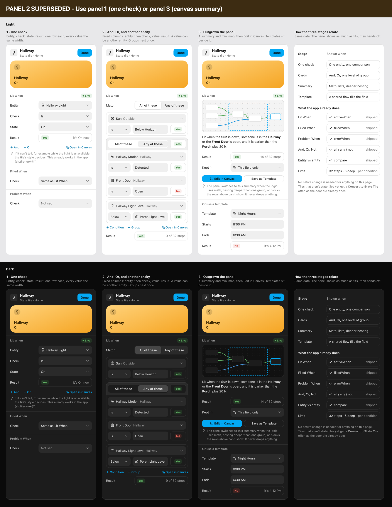

# Flows canvas: design and implementation contract

Status: Lane C design handoff. This document specifies future Studio work; it does
not claim the canvas, the two pending native capabilities, or native delivery
have shipped. Source baseline: `697f638d5e84a2d313f75be70f933c383b1a6afc`.
The existing [design](design.md) and [composition contract](native-composition.md)
still govern everything not changed here.

## 1. Decisions and approved references

**Logic belongs to data, not a component.** A typed output can be used by any
compatible field. A tile is one possible consumer and preview lens, not the
identity, owner, or output type of a flow/template.

**And/Or are edited on the canvas.** The inspector edits one simple check:
Entity, Check, State (or the check's typed value), Result. `+ And`, `+ Or`, and
`Open in Canvas` preserve that check and open the canvas. Two or more checks
always use the summary state, never a stack of in-panel condition cards.

**Live is the default.** Pins, scenarios, a pinned clock, and retained-result
seeds are Studio simulation data, never native configuration or publication.
Save and Publish remain separate, conflict-aware operations.

All seven owner-approved references are retained as PNGs, at 1800 pixels wide
with their aspect ratios preserved. The prose below overrides annotated
conflicts in the images; an illustration is not an additional grammar feature.

| Reference | What to implement; binding qualifications |
| --- | --- |
| [11-panels.png](design/flows/11-panels.png) | Flows: Templates, Flows, Inside a Field. Data: In Use and Everything, grouped by area. Lane B owns the Flows tab, not this lane. |
| [12-canvas.png](design/flows/12-canvas.png) | Two-column Components-like block palette; typed ports/wires; selection inspector; Live / Simulated / Scenarios; limits. `sh.aggregate@1` in the illustration is **not approved**: use the lowering recipes below. |
| [13-sim.png](design/flows/13-sim.png) | Per-block provenance, pinned clock, trace, scenarios and expected outputs. Replay is disabled and labelled Later. |
| [14-preview.png](design/flows/14-preview.png) | Uses, stand-in, Just the Values, Try with, This tile, and setting authoring. Multiple output sockets are a Studio bundle of existing outputs, not a new native multi-output template. An entity-list setting is not a new parameter kind. |
| [15-editor.png](design/flows/15-editor.png) | **Panel 2 superseded.** Keep panel 1's one-check editor and panel 3's summary. Summary begins at more than one check, not an arbitrary size threshold. |
| [16-lists.png](design/flows/16-lists.png) | For Each frame, How Many / Any / All / Average and Each Run. A present literal state `"unavailable"` does not satisfy `state in ["on"]`; it is No, not Can't Tell. A genuinely unanswered read can be unknown. |
| [17-filter.png](design/flows/17-filter.png) | Keep Where / Sort / First Few and Items after Keep Where. Its two condition cards are also superseded: show the summary and Edit in Canvas. |



**15-editor.png: panel 2 superseded.** A supersession banner marks the retained
reference; its panel content is not redrawn to look as though the owner approved
the rejected interaction.

### Capability boundary

Lane A owns promotion of these 20 already-shipped IDs:
`sh.arc-track@1`, `sh.chart@1`, `sh.choice-icons@1`, `sh.count@1`,
`sh.countdown@1`, `sh.dial@1`, `sh.duration-format@1`, `sh.entity-time@1`,
`sh.flow-extras@1`, `sh.grid-state-groups@1`, `sh.linear-gauge@1`,
`sh.math-truncate@1`, `sh.repeat@1`, `sh.stack@1`, `sh.state-words@1`,
`sh.surface-controls@1`, `sh.surface-orientation@1`, `sh.symbol-part@1`,
`sh.text-style@1`, and `sh.tile-swipe@1`.

The only new approved pending native IDs here are:

- `sh.flow-average@1`: `{id, op:"average", value:<operand>}`, the mean of finite
  numbers, skipping null/non-numbers, null when none remain, no rounding.
- `sh.text-keep@1`: text-slot `whenUnavailable:"fallback"|"keep"`; absence means
  fallback. Loading already retains the last answered text. Keep on unavailable
  retains that text, or the authored fallback when no answer has existed.

Tile looks already ship under `sh.tile-look@1`: `activeWhen`, `filledWhen`,
`errorWhen`. No aggregate operand, list parameter kind, executable code,
extra badge visibility property, or raised native limit is authorized.
The native-proposals source audit is compatibility research, not a device test.
Generate capabilities from the lowered document and the actual target manifest,
not the mockup labels or an assumed app version.

## 2. Source of truth, types, and costs

| Contract surface | Authoritative source |
| --- | --- |
| Operands, predicates, scope, field limits | [`expression.ts`](../src/shared/composition/expression.ts), `checkOperand`, `checkPredicate` |
| Flow requests, steps, outputs, limits | [`pipeline/schema.ts`](../src/shared/composition/pipeline/schema.ts), [`typing.ts`](../src/shared/composition/pipeline/typing.ts), [`compile.ts`](../src/shared/composition/pipeline/compile.ts) |
| Runtime values and unknowns | [`evaluator.ts`](../src/shared/composition/evaluator.ts), [`pipeline/evaluate.ts`](../src/shared/composition/pipeline/evaluate.ts) |
| Template definitions and expansion | [`logic-library.ts`](../src/shared/composition/logic-library.ts), `expandLogic`, `expandKeepingHoles`, `assertNoLogic` |
| Text, symbols, literal-look rules | [`slots.ts`](../src/shared/composition/slots.ts) |
| Repeat and consuming nodes | [`schema.ts`](../src/shared/composition/schema.ts), `repeatProps`, `componentEntrySchema` |

Visible wire types are **number, text, yes/no, time, list, entity**. A structural
**record** socket is additionally necessary for the existing `object`, `map`,
and record-flow grammar; it is not mislabelled as an entity or a list. A list
carries its item shape. A record carries named fields. Unknown/union/nullability
come from `Shape`, not inferred from one live sample.

The shared port descriptor carries both `valueType` and `representation`:
`operand`, `condition`, `stream`, or `source-selection`. In particular:

- A yes/no condition is tri-state (Yes / No / Can't Tell), not a boolean operand.
  An explicit `choose` with true/false literals converts a condition to a
  boolean value; a `compare eq` with literal true converts the other way.
  Unknown retains existing evaluator behavior; neither adapter defaults to No.
- Time is text refined as date/date-time, never a new published time scalar.
  A duration is a number plus an explicit unit. Text cannot connect to a
  numeric port just because today's text happens to contain digits.
- Entity value means an entity-id operand. An Entity selector identifying a
  document source has `representation:"source-selection"` and stores its
  `sourceId`; it cannot substitute an entity-id string for a source ID.
- A flow stream and a document list operand are distinct. Rows/records providers
  are not scalar reads. An `any` shape displays Unresolved type and cannot
  bypass destination typing; narrowing requires an existing grammar operation.

In the catalog, `N(x)` is the recursive **expanded AST node count**, not the
number of drawn cards. Each operand or predicate contributes 1; children add
their counts. `D_N(x)` is the combined operand/predicate AST depth, root at 1.
Paths, `from`, cases' containers, formatting options, and count viewer selectors
add no node or depth. These structural totals are not the predicate budget.

`P(c)` counts **predicate nodes only** in one condition scope, and `D_P(c)`
counts predicate nesting only, with the condition root at 1. A compare, numeric,
in or exists leaf contributes 1 regardless of the operands it contains;
all/any/not contribute 1 plus their predicate children. Walking an operand does
not spend this 32-node budget or increase this depth-6 limit. Conditions nested
inside an operand's Choose/count are checked in their own condition scopes.

The separate **expression budget** follows the checker for that context. The
document checker shares a combined operand/predicate counter (normally 64,
128 across a service call) and combined depth 8, alongside predicate-only
checks where applicable. Flow typing instead gives each operand tree entered
from `typeWhere` a fresh 64-node/depth-8 operand budget: it does not pool all
the condition's operands into a synthetic 64-node filter budget. A flow Choose
shares its operand budget across its value branches but types its `when`
conditions separately. Section 5 specifies these interactions and meter scopes.
Do not implement the meter by applying 32 to `N(condition)`.

`S` is a flow-step slot: every step costs one of 32 slots. Nested operands and
conditions still have their context-specific budgets. Runtime flow cost is
separate: step base cost, item visits, and evaluator node visits, with the
existing 100,000 budget. Do not equate AST nodes, predicate nodes, step slots,
or runtime cost.

Inline editable values are stored as fields where the grammar has primitives,
or as explicit literal operand children where it has operands. Hiding a literal
socket behind a text box does not remove its node cost.

## 3. Atomic block catalog (C-catalog)

Palette groups use two-column cells with a Lucide icon, name, and a short type
hint. The search result includes scope and pending-capability badges. Unsupported
scope is disabled with a reason, not shown as a block that only fails on Save.
The tables are exhaustive for the operand/predicate/step variants at baseline.
Options in one row are variants of that named grammar node, not new opcodes.

### 3.1 Values and operands

`D` means a document field; `F` means the allowed flow context; `R` a repeat
cell. Parameter/request/step scopes still apply as described below.

| Group / block / Lucide icon | Inputs -> output | Editable fields | Exact lowering and node cost |
| --- | --- | --- | --- |
| Values / Number, Text, Yes/No, Entity ID / `Hash`, `Type`, `ToggleLeft`, `Tag` | none -> corresponding operand type | Literal value; entity ID validated | `literal`; 1. Structured literal available in Advanced. Null literal is flow-only, not a valid document operand. |
| Data / Read Value / `Database` | source-selection -> number, text, yes/no value, or entity | Source, path, declared `as`; missing fixed to unavailable | `read {from:{type:"source",sourceId,path},as,missing:"unavailable"}`; 1. D or F parameter only. |
| Data / Raw State / `Radio` | entity source-selection -> text | HA source | `raw-state {sourceId}`; 1; D only. Preserves literal unknown/unavailable text. |
| Data / Last Changed / `History` | entity source-selection -> time | HA source | `last-changed {sourceId}`; 1; D only, `sh.entity-time@1`. |
| Data / List Size / `ListOrdered` | source-selection -> number | HA attribute path | `list-count {from}`; 1; D only, path exactly `["attributes",name]`. |
| Data / List Contains / `ListChecks` | source-selection, scalar needle -> yes/no value | HA attribute path | `list-includes {from,value}`; `1+N(value)`; D only. This is not a predicate until explicitly adapted. |
| Data / Viewer Value / `User` | none -> text, entity, or yes/no value | userId / personEntityId / isAdmin | Operand `viewer {field}`; 1; D or F parameter/request, not a step body. |
| Values / Control Value / `SlidersHorizontal` | none -> control's scalar type | Optional named dial stopper | `control {stopper?}`; 1; only its own bound-control service action. Named stopper retains its existing capability/scope gate. |
| Values / This Item / `Box` | frame item -> selected field type, record, or list | Path, including empty path for whole item | `item {path}`; 1; F step/output or R cell, never F request/parameter. |
| Values / Item Position / `ListOrdered` | frame item -> number | None; display 0-based | `index`; 1; F step/output, R cell or R placeholder, `sh.repeat@1`. |
| Values / Flow Setting / `Settings2` | none -> declared scalar type | Existing parameter name | `param {name}`; 1; F only. |
| Time / Clock / `Clock` | none -> time | Today / Now / Now each second | `clock {part:"today"\|"now"\|"now-second"}`; 1. Now each second is not allowed in F. Simulation clock controls do not edit this node. |
| Time / Days Between, Seconds Between / `CalendarClock` | from:time, to:time -> number | Operation | `date {op:"days-between"\|"seconds-between",from,to}`; `1+N(from)+N(to)`. |
| Time / Progress Between / `Timer` | from:time, to:time -> number | Time range; current instant comes from the environment clock | `date {op:"progress",from,to}`; `1+N(from)+N(to)`; `sh.flow-extras@1`. There is no third value operand. |
| Maths / Add, Subtract, Multiply, Divide / `Plus`, `Minus`, `X`, `Divide` | numbers -> number | Ordered operands | `math {op,args}`; `1+sum N(args)`. Add/multiply 2..8; subtract/divide exactly 2. |
| Maths / Minimum, Maximum / `ArrowDown`, `ArrowUp` | 2..8 numbers -> number | Ordered operands | `math {op:"min"\|"max",args}`; `1+sum N(args)`. Scalar operations, not flow reductions. |
| Maths / Round, Truncate / `Hash` | number, optional digits:number -> number | Digits 0..6 | `math {op:"round"\|"truncate",args}`; `1+sum N(args)`; truncate needs `sh.math-truncate@1`. |
| Maths / Clamp / `BetweenHorizontalStart` | value, minimum, maximum:number -> number | Three ordered inputs | `math {op:"clamp",args}`; `1+sum N(args)`. |
| Maths / Scale / `Scaling` | value, from-min, from-max, to-min, to-max:number -> number | Five ordered inputs; units are labels, not implicit conversion | `math {op:"scale",args}`; `1+sum N(args)`. |
| Text / Format / `CaseSensitive` | named scalar arguments -> text | Pattern, per-argument formats | `format {pattern,args,formats?}`; `1+sum N(args)`; at most 16 arguments. |
| Rules / Match Value / `ListFilter` | scalar subject, branch values -> merged branch shape | 1..32 scalar equals cases, otherwise | Operand `map {of,cases:[{equals,then}],otherwise}`; `1+N(of)+sum N(then)+N(otherwise)`. Unlike Choose, existing mixed branch kinds can form a union; preserve them and enforce destination typing. Not the flow map step. |
| Rules / Choose / `GitBranch` | conditions, branch values -> common operand type | 1..16 ordered cases, otherwise | `choose {cases:[{when,then}],otherwise}`; `1+sum(N(when)+N(then))+N(otherwise)`. First match wins. |
| Lists / Make List / `ListPlus` | 0..64 operand items -> list | Ordered items | `list {items}`; `1+sum N(items)`. Not a dynamic entity selector. |
| Records / Make Record / `Braces` | named operands -> record | At most 64 fields | `object {fields}`; `1+sum N(fields)`. Consumer still must accept a record. |
| Lists / How Many Checks / `ListChecks` | 1..32 condition entries -> number | Ordered tests, optional per-entry viewer person IDs | Operand `count {of:[{test,viewer?}]}`; `1+sum N(test)`; D only, never nested in a flow. |
| Templates / Use Output / `Link` | settings by their declared kinds -> declared operand or condition | Existing logic entry, complete args | `logic-ref {logicId,args}`; no surviving reference node: cost is expanded body including every argument copy. |
| Templates / Template Setting / `Settings2` | none -> declared setting type | Name, label, kind, sample, display hint | `hole {name}` only inside a template body; primitive holes also allowed in source-id/text/number fields. Cost is substituted value, not zero after expansion. |

Format options are exactly the existing families: number
`minimumFractionDigits`/`maximumFractionDigits` 0..6; date
`short-date`, `long-date`, `weekday-date`, `time`, `date-time`, `relative`,
`hour`, `weekday`; text `title` or `words`; duration `compact`, `clock`,
`minutes-seconds`, `span`. A seconds/minutes input-unit selector exists only for
compact duration. Hour/weekday use flow-extras; duration uses duration-format.
Do not add arbitrary locale format strings, JavaScript functions, or Jinja.
Paths have at most 8 segments, no numeric array indexing, and no reserved
`__proto__`, `prototype`, or `constructor` segment. Use the existing checker for
the context's segment alphabet/length. Literal text and format patterns retain
their 2000-character limit; structured document literals retain depth 4 and
64 entries per container. Number formats require maximumFractionDigits, with
minimumFractionDigits no greater than it. Seconds Between and Now each second
retain `sh.countdown@1`; none of these UI labels bypass capability derivation.

### 3.2 Checks and rule destinations

| Group / block / Lucide icon | Inputs -> output | Editable fields | Exact lowering and node cost |
| --- | --- | --- | --- |
| Checks / Entity State / `CircleDot` | source-selection -> yes/no condition | Source, path, 1..32 accepted state strings | `state {sourceId,path,in}`; 1; D only. |
| Checks / Entity Number / `Gauge` | source-selection, above?/below?:number -> condition | Source, path, at least one strict bound | `numeric {sourceId,path,above?,below?}`; `1+N(above?)+N(below?)`; D only. |
| Checks / Viewer Matches / `UserCheck` | none -> condition | isAdmin and/or allowed user IDs | Predicate `viewer {isAdmin?,userIds?}`; 1; D only. |
| Checks / Viewer's Person State / `Contact` | none -> condition | Accepted states, e.g. home | `viewer-person {in}`; 1; D only. This reads the person's state, not their entity ID. |
| Checks / Compare / `Equal` | compatible left/right -> condition | Equal, not equal, above, below, before, after | `compare {op:"eq"\|"ne"\|"above"\|"below"\|"before"\|"after",left,right}`; `1+N(left)+N(right)`. |
| Checks / Is One Of / `ListChecks` | value, 1..16 compatible values -> condition | Ordered candidate operands | `in {value,in}`; `1+N(value)+sum N(in)`. |
| Checks / Has Value / `CircleCheck` | operand -> condition | None | `exists {value}`; `1+N(value)`. Null is not a value for this check; document loading/unavailable is unknown. |
| Checks / All Of / `Workflow` | 1..16 conditions -> condition | Input labels/order | `all {of}`; `1+sum N(of)`. |
| Checks / Any Of / `Waypoints` | 1..16 conditions -> condition | Input labels/order | `any {of}`; `1+sum N(of)`. |
| Checks / Not / `CircleSlash` | condition -> condition | None | `not {of}`; `1+N(of)`. |
| Outputs / Text Slot / `TextCursorInput` | scalar operand -> text field | Fallback; pending whenUnavailable | `{type:"expr",value,fallback?,whenUnavailable?}` or existing `read` slot; wrapper adds no expression node. Literal slots remain literal. |
| Outputs / Look Rules / `Palette` | conditions, literal looks -> exact look field | Ordered cases, otherwise | Slot `conditional {cases,otherwise}`; check each `when` in its destination's document-predicate context (section 5), not as a flow filter. No fabricated operand for a color/symbol object. |
| Outputs / Bound Symbol / `Shapes` | text operand -> symbol field | Literal SF Symbol fallback | `bound-symbol {value,fallback}`; operand cost `N(value)`. Keep placement restrictions. |
| Outputs / Action Rules / `MousePointerClick` | conditions, existing action descriptors -> action field | Ordered cases, otherwise | Existing action `conditional` in `compositionActionSchema`; per-case condition costs. Canvas previews never invoke the selected action. |
| Outputs / Field Output / `LogOut` | one compatible value/condition -> destination | Output label, destination, supported unknown policy | No expression node; installs AST at the exact field path. Wrappers/policies are retained, not replaced with a universal output schema. |

A rule's literal colors, fills, symbols, and action descriptors are typed
destination fields, not free-form JSON ports. Keep the existing field editor
for those descriptors. The canvas connects their conditions and preserves the
entire descriptor losslessly.

### 3.3 Data Flow requests, steps, and outputs

Request/output cards are structural endpoints, not step slots. All flow IDs and
step IDs remain authored IDs. Every item operand belongs to its particular step
or output scope, not the item currently selected in a drawer.

| Group / block / Lucide icon | Inputs -> output | Editable fields | Grammar and cost |
| --- | --- | --- | --- |
| Flow Data / Entities / `Blocks` | literal entity selections -> list of records | 1..64 distinct entity IDs; up to 8 distinct attribute names | `request.type:"entities"`; 0S. Rows include entityId, state and requested attributes. Selection order is retained. |
| Flow Data / Value / `Braces` | request-scope operand -> its shape | Value | `request.type:"none",value`; 0S, `N(value)`. |
| Flow Data / Entity Attribute / `Database` | literal entity ID -> authored responseShape | Entity, path, responseShape, refresh | `request.type:"entity-attribute"`; 0S. |
| Flow Data / Service Response / `Download` | permitted target/data operands -> authored responseShape | Domain, response-required service, target, data, timeout, refresh | `request.type:"service-response"`; 0S, operand costs. Only the existing safe server endpoint may run it. |
| Flow Data / Todo Items, Weather Forecast / `ListTodo`, `CloudSun` | literal entity ID -> fixed subscription response shape | Kind, entity; forecast daily/hourly/twice_daily | `request.type:"ha-subscription"`; 0S. This is the contract kind, not a promise of browser push. |
| Flow / Get Field / `CornerDownRight` | record -> selected shape | Path | `get {path}`; 1S. |
| Flow / Select Key / `KeyRound` | record, key:text -> selected shape | Key operand | `select-key {key}`; 1S + `N(key)`. |
| Flow / Keep Where / `ListFilter` | list, item condition -> same list shape | Condition in canvas; one simple check inline only | `filter {where}`; 1S + `N(where)`. Unknown document values enter F as null; a false flow check drops the item. |
| Flow / Sort / `ArrowDownWideNarrow` | list, 1..4 item sort values -> same list shape | Each key's ascending/descending and text/number/date kind | `sort {by:[{value,direction,kind}]}`; 1S + sum of key operand costs. Preserve stable ordering rules. |
| Flow / First Few / `ListStart` | list -> same list shape | Count 1..1000 | `limit {count}`; 1S. This is not the rows/records output max. |
| Flow / Make Fields / `Braces` | record or list, item field operands -> record or list of records | 1..32 named fields | Step `map {fields}`; 1S + sum of operand costs. Replaces fields; explicitly carry fields needed downstream. |
| Flow / Group By / `Layers` | list, scalar key -> list of group records | Key operand | `group {by}`; 1S + `N(by)`; records have key, count, items. |
| Flow / How Many Items / `ListOrdered` | list -> number | None | Step `count`; 1S. Different from document operand count. |
| Flow / Sum / `Sigma` | list, item number -> number | Value operand | `sum {value}`; 1S + `N(value)`; empty answer 0. |
| Flow / First Item / `ListStart` | list -> item or null | None | `first`; 1S. |
| Flow / Flatten / `UnfoldVertical` | list -> flattened list | Path; empty allowed | `flatten {path}`; 1S. |
| Flow / Unique / `CopyCheck` | list, scalar key -> same list shape | Key operand | `unique {by}`; 1S + `N(by)`; retains first occurrence. |
| Flow / Default Field / `Replace` | record or list, operand -> same structural kind | Path, replacement | `default {path,value}`; 1S + `N(value)`; fills absent/null only, not a missing parent object. |
| Flow / Minimum, Maximum / `ArrowDown`, `ArrowUp` | list, item number -> number or null | Value operand | `min` / `max {value}`; 1S + `N(value)`; `sh.flow-extras@1`. |
| Flow / Running Sum / `ChartNoAxesCombined` | list of records, item number -> annotated list | value, into, required nullPropagates | `running-sum {value,into,nullPropagates}`; 1S + `N(value)`; flow-extras. |
| Flow / Add Range Fields / `BetweenHorizontalStart` | list of records, item numbers -> annotated list | 1..32 named fields with aggregate min/max and value | `annotate {fields:{name:{aggregate,value}}}`; 1S + sum of operand costs; flow-extras. |
| Flow / Average / `Sigma` | list, item number -> number or null | Value operand; display decimals belong to a downstream Format | Pending `average {value}`; 1S + `N(value)`. Without target support use the explicit two-flow recipe in section 5. |
| Flow Outputs / Value, Record / `LogOut`, `Braces` | final scalar or record -> typed exported output | output.kind, authored schema | `output.kind:"scalar"\|"record"`; 0S. Scalar read path is `["value"]`; record field paths are named fields. |
| Flow Outputs / Rows / `Rows3` | list, row operands -> rows provider | max 1..100; row id/title/subtitle?/value? | `output:{kind:"rows",max,row}`; 0S + row operand costs. |
| Flow Outputs / Records / `TableProperties` | list of records -> records provider | max 1..100; authored item schema | `output:{kind:"records",max}`; 0S; `sh.repeat@1`. Not a scalar or row-collection read. |

Every step above also has `{id,op}`. The compiler, not a palette assumption,
determines its full shape and nullable result. `parameters` are at most 8 typed
scalar parameters (`string`, `number`, `boolean`, `entity-id`). Only parameter
values can read document sources or other scalar/record flows. Requests may use
parameters/viewer/clock where allowed; step/output bodies use item/parameters.
Document leaves state/numeric/viewer predicates, raw-state, last-changed,
list-count/list-includes and operand count are not legal flow substitutes.

### 3.4 Frames and explicit recipes, not extra grammar

| Group / construct / Lucide icon | Ports and fields | Lowering/cost |
| --- | --- | --- |
| Lists / For Each / `Repeat2` | Static entity selection or typed list stream; scoped item and index; nested check/value; reducers | Presentation frame, 0 nodes itself. Lower to enumerated document tests or flow step item scope, as section 5 specifies. Never emit `for-each`. |
| Lists / Any, All / `Waypoints`, `Workflow` | Frame check -> condition | Count and Compare recipes, not new aggregate operators; counts and comparisons contribute their complete expanded cost. |
| Maths / Average Fixed Values / `Sigma` | 2..8 numeric operands -> number | Explicit strict arithmetic recipe: `math divide(math add(values),literal length)`. Cost `3+sum N(values)`. All inputs must answer; no skipping. Label "Fixed values - Can't Tell if missing". This is distinct from the list Average step. |
| Repeat / Draw Records / `Repeat2` | records provider -> existing repeat consumer | `repeat` node with props providerId, axis, spacing, limit, paging, placeholder and five state texts; no expression node for the container. `item` is available only in the first child; placeholder allows only index. Editing cell layout stays in the component editor. |
| Templates / Bundle Outputs / `PanelsTopLeft` | Named existing typed outputs -> matching destinations | Studio organization only. Each output names a separate logic entry, flow scalar/record field, or provider. No native multi-output logic-ref. |

For Each is not native repeat: the former evaluates logic; the latter draws
records. A display-only group frame also costs 0 and cannot change evaluation.
Recipes are disclosed in the inspector's "Works out to" section and the limits
meter. Lifting does not recognize and collapse a recipe unless its complete
structure matches; an arbitrary divide must not be relabelled Average.

## 4. Graph model and draft storage

### Shared boundary agreed before parallel coding

The first implementation deliverable is
`src/shared/composition/graph/types.ts`. All lanes import it. It defines
`LogicAnchor`, `PortType`, `GraphNode`, `GraphEdge`, `LogicGraph`,
`GraphDiagnostic`, `GraphBudget`, `LoweringResult`, `LiftResult`,
`StudioCanvasMetadata`, `LogicUseBinding`, `SimulationCase`, `TraceEvent`, and
`CanvasHost`. No UI lane invents an alternative serialized graph or evaluator.

Minimum normative members:

| Type | Required contract |
| --- | --- |
| LogicAnchor | Stable container kind/id (`page`, `modal`, `component`, `logic`, `flow`, or `document`), nodeId when relevant, and RFC 6901 field pointer relative to that owner. Array positions are resolved at access time, not saved as node identity. A document-only pointer also carries the original subtree fingerprint. |
| GraphNode | Studio ID; catalog key; discriminated grammar payload; typed ordered input/output ports; scope ID; ordered AST origins; provenance (lifted/authored/opaque). Payload uses existing Operand/Predicate/Pipeline types, not an untyped executable object. |
| GraphEdge | Studio ID; from node/port; to node/port; one AST binding location for that input. A flow stream edge is distinguished from an operand edge. |
| LogicGraph | Version 1; ordered roots with anchors and destination constraints; nodes; edges; frames/scopes. Values/positions and temporary pins are not part of semantic equality. |
| GraphDiagnostic | Severity, existing code where applicable, message, anchor, node/port IDs, AST pointer; no raw HA error payload. |
| GraphBudget | Per lowered root: informational total AST nodes/depth; separately identified expression-budget scopes and predicate-only scopes, each with its own node/depth counts and limits; cases, steps, capabilities, duplicated-use cost and generated flow count. Scope IDs/pointers distinguish a document's shared expression counter, a call's shared 128-node counter, and fresh flow operand counters. Diagnostics name the actual exceeding scope/pointer. |
| LoweringResult | Either success with AST replacements, generated sources/library entries, source map and budgets; or errors with the original document unchanged. No partial success document. |
| LiftResult | Graph, source map, opaque regions, warnings; lossless original fragments retained. |
| CanvasHost | Open by anchor/output; immutable draft snapshot and revision; atomic apply transaction; existing save/conflict hooks; workspace data/target capabilities; typed callbacks for uses and preview lens. |

Graph rules: each input has **at most one incoming output**, and exactly one
when required for Apply. Variadic blocks have separately named inputs. Fan-out
is allowed. Cycles, including template/flow dependencies and cross-frame cycles,
are forbidden. Ports must match type, representation, nullability and scope;
no implicit coercion, list broadcasting, or crossing an item scope. Compound
ports can offer a labelled explicit adapter with visible generated cost.
Disconnects, drafts of a new block and temporarily incomplete rules may exist
in the canvas working buffer, but cannot overwrite the last valid canonical AST.

### Canonical logic and expendable presentation metadata

Canonical executable logic remains in the existing field AST, `logicLibrary`, and
`dataSources` pipeline sources. The graph is an editing projection, **not an
alternate runtime language**. The proposed optional draft key is
`document.studioCanvas`; it attaches layout to logic anchors:

```json
{
  "studioCanvas": {
    "version": 1,
    "canvases": [
      {
        "id": "canvas-too-warm",
        "roots": [
          {"kind": "logic", "id": "too-warm-warning", "field": "/body"}
        ],
        "nodes": [
          {"id": "check-window", "origins": ["/logicLibrary/0/body/of/1"], "x": 384, "y": 240}
        ],
        "viewport": {"x": 0, "y": 0, "zoom": 1},
        "groups": [{"id": "inputs", "label": "Room inputs", "nodeIds": ["check-window"]}]
      }
    ],
    "bundles": [
      {
        "id": "warm-warning",
        "name": "Too Warm Warning",
        "outputs": [
          {"name": "Warning", "logicId": "too-warm-warning"},
          {"name": "Subtitle", "logicId": "too-warm-subtitle"}
        ]
      }
    ]
  }
}
```

This is a **proposed Studio draft extension**, not accepted by today's strict
document schema. Lane W2-D adds tolerant extraction at draft preprocessing,
before strict native grammar validation. Layout parsing failure, stale origins,
or an unknown layout version must not invalidate otherwise valid logic: retain
the raw metadata for lossless draft storage, warn "Saved layout can't be used",
and lift with auto layout. Reset layout is explicit. Never use layout coordinates,
group membership or bundle labels to determine behavior. Missing metadata is
equivalent to a fresh auto layout. Invalid semantic AST is still invalid.
Existing outer JSON safety/size limits still apply.

Generated node IDs must work on ordinary LAN HTTP: reuse the repository's ID
helper/collision checks, not unguarded `crypto.randomUUID()`. Matching uses stable
owner IDs and a source map; an old array index never silently targets another
node. If ambiguous, ignore that layout association and report it.

Strip the root `document.studioCanvas` before publication, capability calculation
and native validation; refuse that root field in publication envelopes. Do not
delete equally named properties inside arbitrary literal data.
All publication entry points must use the same preparation helper, including
the store, HTTP publish/download paths and HA publication service. Existing
`publishedDocument` expansion alone does not strip this future key.

### Behavior-bearing "Fill from the tile" is not layout

Automatic argument selection cannot live solely in discardable positions or
group metadata. Use a separate proposed draft key, `document.logicUseBindings`,
validated strictly and resolved before logic expansion:

```json
{
  "logicUseBindings": [
    {
      "use": {"kind": "page", "id": "home", "nodeId": "climate-tile", "field": "/props/subtitle/value"},
      "argument": "thermostat",
      "from": {"kind": "use-tile", "field": "/props/sourceId"}
    }
  ]
}
```

The addressed AST must be a `logic-ref`, its declared argument kind must be
`source-id`, and the consumer must expose exactly that source-valued tile field.
Use a registry of source-valued fields from existing component definitions;
there is no arbitrary ancestor search, executable selector or ambient "current
tile". Inside a component definition, the anchor is component-local and the
existing component binding machinery must carry the resolved source through
each use's expansion/private-source remapping. Existing string bindings into
logic args continue to work; do not expand components in the wrong order.

This first version offers automatic fill only for `source-id`. Other parameter
kinds use explicit arguments; do not invent an entity-list kind or guess a text/
number from the tile. The UI offers This tile only when resolution is unambiguous.
At authoring, write the resolved explicit argument as well as the binding.
At every preview/validation/publish expansion, resolve again against that use.
An unresolved target, wrong type, duplicate target/argument, changed ref, or
missing owning tile is a **semantic binding error**, not a discarded layout
warning. Never silently use a stale cached argument.

Bindings are declarative Studio preprocessing, not new native nodes/capabilities.
Cap at 128 bindings per document, retain existing per-component binding limits,
and run the existing expanded-size/depth checks. This is a new Studio-only bound,
not a native limit increase. Removing automatic fill materializes the currently
resolved explicit argument in one undoable transaction. Published output contains
neither `logicUseBindings` nor refs/holes/library/layout. Draft import/export
retains semantic bindings and layout; scenarios remain browser-local.

## 5. Lowering, budgets, and compatibility (C-lower-lift)

### Deterministic lowering

1. Resolve roots/destination types and use-bound settings without mutating input.
   Validate graph connections, scopes, cycles, and required ports.
2. Walk each root in stable port/case/item order. Emit the named grammar nodes;
   preserve authored IDs and optional-field presence. A shared node used twice
   emits two AST subtrees unless it is an explicit existing flow/reference.
3. Lower linear flow paths to request -> ordered steps -> output. A fork to two
   terminal reductions requires two sources with duplicated prefixes: pipeline
   grammar is not a branching execution graph. Allocate stable IDs once in the
   applied transaction; show generated flows and their uses. Never hide them
   from the document or silently deduplicate network effects.
4. Expand template uses and use-bound args; compute capabilities and actual
   post-expansion costs; run the existing whole-document compiler and target
   compatibility checks. The success source map maps every generated pointer
   back to the responsible block/port/use.
5. Apply all replacements together as one undoable edit. Save uses the existing
   revision precondition. A conflict preserves the canvas buffer/local edits
   and offers comparison/retry, never "saved" followed by discarded work.

### For Each, How Many, Any, All

For a fixed selection of 1..32 declared document sources and document checks,
For Each + How Many lowers to `count.of`, substituting each source ID into the
test. The frame/item placeholder is Studio-only; no `item` escapes into this
document count. Each count test has its own **32-predicate-node/depth-6**
budget; its operand nodes do not spend that predicate budget. The **whole count
expression**, including all predicate and operand nodes in every test, must
still fit the shared 64-node/depth-8 expression budget. Thirty-two simple state
tests cost 33 expression nodes; thirty-two more complex tests may not fit.

Any in this count recipe is `compare above(count,0)`. All for the fixed unfiltered
selection is `compare eq(count,selectedLength)`. These mean "at least one counted"
and "every selected entry counted", not an undocumented change to Kleene `any`/
`all`. With per-entry viewer exclusions, All needs a second eligible count
(same viewer selectors, always-true tests) as its denominator; count both
expanded trees against the field budget. If that cannot fit, report it.
Do not count excluded entries or silently change an unknown result to false.

Count preserves source semantics: Yes increments; No does not; unknown entries
are skipped. All eligible tests unanswerable gives loading if any are loading,
otherwise unavailable. All viewer-excluded gives 0. Missing viewer context with
viewer-filtered entries gives loading. Duplicate count entries count twice.
The drawer distinguishes all of these from a present state string
`"unavailable"` that simply does not match `"on"`.

For 33..64 entities, list transformations, or list reductions, use a Data Flow
with an `entities` request and step-scoped `item`. Entity IDs must be distinct;
source IDs are resolved to literal entity IDs at authoring, with the selection
visible. Area selection is an authoring convenience that materializes a list,
not a new native dynamic area query. Requests select at most 8 attributes.
Never silently convert an existing count to a flow: their missing-data/viewer/
duplicate semantics differ. Show that difference and require an explicit change
of mode. More than 64 entities is an error, not invisible chunking.

A flow Any is filter -> count, read its scalar and compare above 0. Flow All
compares matching count to total count (or the known entity-list length when
equivalent). Distinct terminal counts require distinct flow sources. For generic
empty lists Any is No and All is Yes; document count selections cannot be empty.
For Each never lowers to nested `count` inside a flow, and native `repeat`
remains a separate renderer consuming a records output.

### Average: supported step, fallback, and strict scalar recipe

List Average means **skip missing/non-numeric values**, not zero-fill. If the
actual target supports `sh.flow-average@1`, emit
`{id:"average",op:"average",value:<numeric item operand>}`. Static typing must
accept number/null, not arbitrary text. Empty/all-missing gives null. Formatting
decimals is a subsequent Format, not rounding the reduction.

Otherwise emit exactly two flows over the same request and preprocessing:
one `sum`; one `filter` on `exists` of the normalized numeric value, then
`count`. A document `math divide` of the two scalar reads is the mean.
Zero valid items gives divide-by-zero/unavailable in the field; do not return
zero or the count of all source rows. Both flow slots, both prefixes and all
reads count. Entity requests use the same captured snapshot in Studio simulation.
Do not silently migrate an existing authored average during publish: selecting
a target-compatible fallback is an explicit, undoable graph edit.

For entity **state text**, the preprocessing step is:

```json
{
  "id": "numbers",
  "op": "map",
  "fields": {
    "value": {
      "type": "math",
      "op": "add",
      "args": [{"type": "item", "path": ["state"]}, {"type": "literal", "value": 0}]
    }
  }
}
```

**Known prerequisite A-number-state:** at this baseline `entities.state` is
statically `string`; `typeStep` rejects this at
`/steps/0/fields/value/args/0` with `binding_type`, although `runStep` converts
`"23.6"` to `23.6`. This JSON is the required normalization recipe, **not a
claim that the baseline compiler accepts it**. Lane A must reconcile the
shipped numeric conversion's typing with the corpus/native contract before this
state-list average path is enabled. No cast opcode, fake `responseShape`,
`any` escape, or unapproved native capability is allowed. Until that evidence
exists, surface the reason and disable this recipe. Numeric attributes and
typed numeric parameter inputs do not have this specific text-shape problem.
Do not block unrelated canvas work on it.

The mockup's **Can't Tell if any fixed input is missing** is instead the
explicit Average Fixed Values arithmetic recipe in section 3.4. This is how
the two scalar temperature inputs in the next example lower. It is not labelled
the skip-missing list average step. A list-average "Can't Tell" toggle must not
be shown as supported without an exact validated lowering; the approved
average step itself has no such option.

### Limits meter

Use the counters and scope boundaries in `expression.ts` (`Checker.enter`,
`Checker.predicate`, `Checker.call`) and `pipeline/typing.ts` (`typeOperand`,
`typeWhere`). A predicate leaf's operand may be deep or wide without using
additional predicate nodes/depth, but it must still pass its expression check.
No limit is raised or replaced by a canvas-specific approximation.

| Boundary | Exact existing bound and interaction |
| --- | --- |
| Document field operand | One shared 64-node expression budget counts **all operand and predicate nodes**, including Choose conditions/branches and count tests; combined AST depth is at most 8 from the field root. |
| Document Choose `when` / count `test` | Each condition starts a 32-**predicate**-node/depth-6 check. All of its predicates **and operands** also spend the enclosing expression budget above; entering the condition does not reset that expression counter or combined depth. |
| Standalone document predicate, including a look-rule `when` checked through `usePredicate` | Combined 64-node/depth-8 expression check; no separate top-level 32-predicate-node/depth-6 cap. Nested Choose/count conditions retain their own checks. Preserve previously valid larger visibility/look conditions. |
| Service-call context | Shared **128-node** expression counter across data, target operands and additional confirmation condition; combined depth 8, rooted separately at each data/target/confirmation entry. `confirmation.when` additionally starts a predicate-only 32/depth-6 check; nested Choose/count checks also apply. Do not give each call operand a fresh 128 nodes or incorrectly cap it at 64. |
| Flow filter / `typeWhere` | 32 **predicate nodes**, predicate depth 6. Each operand entered from a leaf gets a fresh `typeOperand` budget of 64 nodes/depth 8, rooted at that operand. There is no shared `N(where) <= 64` or combined condition-plus-operand depth-8 test in this typing path. |
| Flow operand / `typeOperand` | 64 nodes/depth 8 along its operand walk; value branches share that counter. A nested Choose calls `typeWhere` separately for each `when`, with its own predicate budget and fresh leaf-operand budgets. Do not add those separate condition walks to the enclosing operand counter. |
| Rule cases | 16, preserving order; map-value cases are a different 32-case construct |
| Flow | 32 steps, 8 parameters, runtime budget 100,000; 128 flow sources/document at this baseline |
| Other | Count entries 32; entities 64; all/any inputs 16; list/shape/path limits from the compiler |

**Required accepted regression:** `all` of 16 comparisons, each comparing two
number literals. The condition has `N=49`, `D_N=3`, but only `P=17`, `D_P=2`.
It is not a 49-of-32 condition failure.

| Placement of that same condition | Expression accounting | Predicate accounting | Expected result |
| --- | --- | --- | --- |
| One-case document Choose, with literal then/otherwise | Entire Choose `N=52/64`, combined depth `4/8` | `when`: `P=17/32`, predicate depth `2/6` | Accepted; compact meter shown for the expression count |
| One-entry document count | Entire count `N=50/64`, combined depth `4/8` | `test`: `P=17/32`, predicate depth `2/6` | Accepted; compact meter shown for the expression count |
| Flow filter | Informational condition AST total 49; each literal operand is independently `1/64`, depth `1/8` | `where`: `P=17/32`, predicate depth `2/6` | Accepted; no compact meter from these scopes alone |

The compact meter appears when **any applicable budget ratio is strictly greater
than 75%**. Label the dimensions separately: Expression nodes / Expression depth
and Predicate nodes / Predicate depth, with the owning field/case/test/operand
pointer. Examples: expression nodes 48/64 hidden, 49/64 shown; call nodes 96/128
hidden, 97/128 shown; predicate nodes 24/32 hidden, 25/32 shown; expression depth
6/8 hidden, 7/8 shown; predicate depth 4/6 hidden, 5/6 shown; cases 13/16 shown;
steps 25/32 shown. A flow condition's aggregate AST count has no single
expression-budget denominator; it is informational while its actual predicate
and operand scopes remain bounded.

Details are always reachable from "Limits", including scopes whose compact
meter is hidden. At a maximum, Apply is allowed if valid; past it, show the
actual compiler error and disable Apply/Save for that edit. A predicate count
under 32 does not excuse a document expression over 64, and an AST count over
32 does not imply a predicate overflow. Existing valid document save/publish
is not replaced by an invalid graph buffer.

Show separate meters for multiple outputs, with the worst one summarized.
Templates show **per-use expanded costs**, not just the small definition.
Expose duplicate expansion and the actual exceeding path. Do not silently drop
nodes, truncate lists, round values, flatten conditions or increase limits.

### Worked JSON A: Too Warm Warning

These are draft document fragments, not a complete publication envelope.
Declare HA sources `living-temperature`, `bedroom-temperature`, `thermostat`,
and `window` in the surrounding document. They respectively read sensor state,
sensor state, a climate entity's `attributes.temperature`, and a binary sensor
state. The template entries and use are valid existing grammar:

```json
{
  "logicLibrary": [
    {
      "id": "too-warm-warning",
      "name": "Too Warm Warning",
      "kind": "condition",
      "params": [],
      "body": {
        "type": "all",
        "of": [
          {
            "type": "compare",
            "op": "above",
            "left": {
              "type": "math",
              "op": "divide",
              "args": [
                {
                  "type": "math",
                  "op": "add",
                  "args": [
                    {"type": "read", "from": {"type": "source", "sourceId": "living-temperature", "path": ["state"]}, "as": "number", "missing": "unavailable"},
                    {"type": "read", "from": {"type": "source", "sourceId": "bedroom-temperature", "path": ["state"]}, "as": "number", "missing": "unavailable"}
                  ]
                },
                {"type": "literal", "value": 2}
              ]
            },
            "right": {
              "type": "math",
              "op": "add",
              "args": [
                {"type": "read", "from": {"type": "source", "sourceId": "thermostat", "path": ["attributes", "temperature"]}, "as": "number", "missing": "unavailable"},
                {"type": "literal", "value": 2}
              ]
            }
          },
          {"type": "state", "sourceId": "window", "path": ["state"], "in": ["off"]}
        ]
      }
    },
    {
      "id": "too-warm-subtitle",
      "name": "Too Warm Subtitle",
      "kind": "operand",
      "params": [],
      "body": {
        "type": "choose",
        "cases": [
          {"when": {"type": "logic-ref", "logicId": "too-warm-warning", "args": {}}, "then": {"type": "literal", "value": "Too Warm"}}
        ],
        "otherwise": {"type": "literal", "value": "Comfortable"}
      }
    }
  ],
  "subtitle": {
    "type": "expr",
    "value": {"type": "logic-ref", "logicId": "too-warm-subtitle", "args": {}},
    "fallback": "Temperature unavailable"
  }
}
```

The sample root `subtitle` stands for the actual consumer's subtitle field, not
a new document root property. Lifting the warning yields two Read blocks,
Average Fixed Values, thermostat Read, margin Number, Add, Compare, window
State, All Of and output. Lifting the subtitle keeps its template reference
as a use, with Expand View to inspect the shared definition.

The warning costs 11 expanded AST nodes, combined depth 5. The subtitle costs
14 expression nodes, combined depth 6; its embedded condition has 11 AST nodes/
depth 5, but only 3 predicate nodes/predicate depth 2 for the separate 32/6 check.
Two outputs share one authoring canvas but remain separate library entries.
At live values 23.6 and
21.9, mean 22.75 is not above 24: No / Comfortable. Pin bedroom to 25:
mean 24.3, threshold 24, window `"off"`: Yes / Too Warm. At exactly 24 the
strict comparison is No. Opening the window makes the final All Of No.
A missing temperature makes the strict mean unavailable; a loading read makes
it loading. With the window closed, either gives an unknown condition and a
stalled Choose (`loading`), rather than silently Comfortable. That slot already
keeps answered text under the existing loading policy. The pending keep option
also covers operands that directly answer unavailable; do not misrepresent the
stalled-Choose behavior as a new capability.

"Badge When" in the mockup is a friendly output label, **not** a native field.
A consumer can put the condition in an existing visibility/looks field, or use
an explicit `choose` in a numeric badge `value` (1 for Yes, 0 otherwise).
The badge follows its existing zero/loading/unavailable policy; no new
`badge.when` or independent "hide on unknown" policy is invented here.
Add `whenUnavailable:"keep"` to the text slot only with `sh.text-keep@1`;
the example deliberately uses the baseline fallback form.

### Worked JSON B: For Each Downstairs Light

Five declared sources `light-a` through `light-e` correspond to the five literal
entity IDs below. How Many is a document count, not a flow count. Use the same
reference for a count display, Any (`above 0`), and All (`eq 5`):

```json
{
  "logicLibrary": [
    {
      "id": "lights-on",
      "name": "Downstairs Lights On",
      "kind": "operand",
      "params": [],
      "body": {
        "type": "count",
        "of": [
          {"test": {"type": "state", "sourceId": "light-a", "path": ["state"], "in": ["on"]}},
          {"test": {"type": "state", "sourceId": "light-b", "path": ["state"], "in": ["on"]}},
          {"test": {"type": "state", "sourceId": "light-c", "path": ["state"], "in": ["on"]}},
          {"test": {"type": "state", "sourceId": "light-d", "path": ["state"], "in": ["on"]}},
          {"test": {"type": "state", "sourceId": "light-e", "path": ["state"], "in": ["on"]}}
        ]
      }
    }
  ],
  "any": {
    "type": "compare", "op": "above",
    "left": {"type": "logic-ref", "logicId": "lights-on", "args": {}},
    "right": {"type": "literal", "value": 0}
  },
  "all": {
    "type": "compare", "op": "eq",
    "left": {"type": "logic-ref", "logicId": "lights-on", "args": {}},
    "right": {"type": "literal", "value": 5}
  }
}
```

`any` and `all` above designate example predicate roots, not new document
properties. Count costs 6 nodes/depth 2; either comparison costs 8/depth 3.
The canvas may show one repeated test in a For Each frame, but the meter counts
all five copies. Without frame metadata, lifting can safely show five tests;
it must not infer a future dynamic light group from those IDs.

The Average Brightness branch is a list reduction. This baseline-compatible
fallback explicitly converts HA brightness (0..255) to percent before both
reductions. Missing brightness remains null, not 0. It uses two flows:

```json
{
  "dataSources": [
    {
      "id": "brightness-sum", "kind": "model", "model": "pipeline@1",
      "inputs": {
        "title": "Downstairs brightness total", "parameters": [],
        "request": {
          "type": "entities",
          "entityIds": [
            {"type": "literal", "value": "light.demo_a"},
            {"type": "literal", "value": "light.demo_b"},
            {"type": "literal", "value": "light.demo_c"},
            {"type": "literal", "value": "light.demo_d"},
            {"type": "literal", "value": "light.demo_e"}
          ],
          "attributes": ["brightness"]
        },
        "steps": [
          {
            "id": "percent", "op": "map",
            "fields": {
              "value": {
                "type": "math", "op": "scale",
                "args": [
                  {"type": "item", "path": ["brightness"]},
                  {"type": "literal", "value": 0},
                  {"type": "literal", "value": 255},
                  {"type": "literal", "value": 0},
                  {"type": "literal", "value": 100}
                ]
              }
            }
          },
          {"id": "total", "op": "sum", "value": {"type": "item", "path": ["value"]}}
        ],
        "output": {"kind": "scalar"},
        "schema": {"kind": "number"}
      }
    },
    {
      "id": "brightness-valid-count", "kind": "model", "model": "pipeline@1",
      "inputs": {
        "title": "Downstairs available brightness count", "parameters": [],
        "request": {
          "type": "entities",
          "entityIds": [
            {"type": "literal", "value": "light.demo_a"},
            {"type": "literal", "value": "light.demo_b"},
            {"type": "literal", "value": "light.demo_c"},
            {"type": "literal", "value": "light.demo_d"},
            {"type": "literal", "value": "light.demo_e"}
          ],
          "attributes": ["brightness"]
        },
        "steps": [
          {
            "id": "percent", "op": "map",
            "fields": {
              "value": {
                "type": "math", "op": "scale",
                "args": [
                  {"type": "item", "path": ["brightness"]},
                  {"type": "literal", "value": 0},
                  {"type": "literal", "value": 255},
                  {"type": "literal", "value": 0},
                  {"type": "literal", "value": 100}
                ]
              }
            }
          },
          {"id": "valid", "op": "filter", "where": {"type": "exists", "value": {"type": "item", "path": ["value"]}}},
          {"id": "count", "op": "count"}
        ],
        "output": {"kind": "scalar"},
        "schema": {"kind": "number"}
      }
    }
  ],
  "subtitle": {
    "type": "expr",
    "value": {
      "type": "format",
      "pattern": "{on} On \u00b7 {brightness}%",
      "args": {
        "on": {"type": "logic-ref", "logicId": "lights-on", "args": {}},
        "brightness": {
          "type": "math", "op": "divide",
          "args": [
            {"type": "read", "from": {"type": "source", "sourceId": "brightness-sum", "path": ["value"]}, "as": "number", "missing": "unavailable"},
            {"type": "read", "from": {"type": "source", "sourceId": "brightness-valid-count", "path": ["value"]}, "as": "number", "missing": "unavailable"}
          ]
        }
      },
      "formats": {"brightness": {"number": {"maximumFractionDigits": 0}}}
    },
    "fallback": "Brightness unavailable"
  }
}
```

This field costs 10 expanded nodes/depth 3, with separate 2-step and 3-step flow
budgets. With states on/on/on/off/unavailable and brightness 204, 140, 130,
null, null, the rounded percent display is 80, 55, 51, skipped, skipped;
the unrounded average is about 61.96%, displayed **3 On · 62%**. Any is Yes,
All is No. The count and average use different subsets deliberately: do not
silently add an On filter to Average. Authors can add that filter explicitly.

For a supporting target, keep the same request/map and replace the terminal
sum with the pending average step below, remove the now-unused count flow only
after a uses check, and read the one scalar result. This replacement is pending,
not accepted by the baseline schema:

```json
{"id": "average", "op": "average", "value": {"type": "item", "path": ["value"]}}
```

## 6. Lifting and lossless round trips

Lift every supported operand/predicate variant and every flow request/step/
output listed above, retaining primitive fields, IDs, rule order, duplicate
entries, optional-property presence, format options, refresh/clock settings,
viewer filters, wrappers/fallbacks and capability gates. Keep source identity
separate from display names. Template refs lift as refs by default, not an
irreversible inline expansion.

Auto layout is deterministic: inputs left, dependencies in topological columns,
outputs right; original AST/step order breaks ties; port order follows grammar
field/case order. For Each scopes are nested, not crossed by a global wire.
Existing good positions win. New nodes lay out near their connected scope.
Auto Arrange is explicit and undoable, with reduced-motion support. Coordinates
never determine evaluation or screen-reader order.

Required invariant for unedited, supported logic:
`canonicalJSON(lower(lift(ast)).ast) === canonicalJSON(ast)`, ignoring JSON key
ordering only, not missing versus present fields or array order. The source map
allows a shared visual node to retain distinct original occurrences. No
common-subexpression rewriting on lift.

An unrepresentable or future fragment is an **opaque read-only block** with its
exact JSON, original pointer and "Can't show this as blocks" reason. It remains
in the round-trip document. Compatible untouched surroundings can still be
edited; any edit requiring interpretation of that opaque region is blocked.
Never drop a field, default an unknown operator, or write a "best effort" AST.
An invalid imported document stays invalid with diagnostics; opaque display is
not permission to publish it. Invalid/untrusted JSON remains subject to existing
duplicate/reserved-key and resource-boundary checks.

Test strategy for W2-G:

- Property tests generate bounded valid ASTs from the actual grammar, including
  nested rules/refs, holes, shared graphs, nullability, scopes, and all optional
  fields. Verify lift/lower equality, evaluator equivalence, deterministic layout,
  exact cost/source maps and input immutability. Shrink failures.
- Traverse all applicable logic in `contract/corpus/accept`, pending cases the
  Studio accepts, `contract/corpus/evaluation`, and `contract/corpus/pipelines`.
  Keep expected refusals and first issue pointers for reject cases. Files marked
  `compiles:false` prove total evaluation, not acceptance.
- Include the two worked examples and boundary pairs: expression nodes 64/65
  and depth 8/9 in their actual checker scopes; shared call nodes 128/129;
  predicate-only nodes 32/33 and predicate depth 6/7 where those checks apply;
  cases 16/17, steps 32/33, count entries 32/33, entities 64/65. **G-limits must
  accept all of 16 literal comparisons in a document Choose, a document count
  test and a flow filter**, with the separate counts/depths and compact-meter
  outcomes in section 5. Also test that flow leaf operands get fresh budgets
  while document condition operands spend the enclosing expression's budget.
  Include fan-out expansion, a cycle,
  duplicate inputs, incompatible ports, count inside a flow, all-missing means,
  unavailable state strings, and a standalone document predicate above 32.
- Future unknown nodes/keys and malformed layout must survive draft reopening
  without being published or silently "repaired". Verify the exact unsupported
  pointer and the complete untouched subtree.

## 7. Field editor and entry points

### Three states, one condition interaction

**Literal/unconfigured:** keep the existing literal control and "Use logic"
entry. Choosing a template/flow filters outputs by destination type/scope.
Do not force a canvas for a plain text or number edit.

**One simple check:** show Entity, Check, State/value, read-only Result. Result
has value/provenance/freshness, not a toggle that alters logic. `+ And` opens
the canvas with an All Of containing the existing check and a focused
Add another check input. `+ Or` does the same with Any Of. **Open in Canvas
also opens prewired into All Of**, the default conjunction; the author can
change it to Any Of. The empty add-input is an affordance, not a second
serialized condition. Stage this wrapper as an explicit canvas edit after
the lossless lift, not a rewrite in `lift` itself. Nothing is written until
Apply, and closing/discarding preserves the exact original single check.

**Summary:** every field with more than one check, or a construct not expressible
as the simple editor, shows a one-sentence semantic summary, a non-interactive
mini map with a text equivalent, Result, **Edit in Canvas**, and **Save as
Template**. The mini map is not a tiny inaccessible editing surface.
There are no in-panel compound condition cards, including Keep Where.

Entry points cover every existing logic-taking field:

| Destination | Canvas root/adaptation; preserve |
| --- | --- |
| Any text/expr slot, including titles/subtitles/profile/settings text | Scalar operand; existing literal/read/expr form, format arguments, fallback and supported whenUnavailable |
| `visibleWhen` on a node/tab/block or other supported owner | Condition; that owner's `whenUnknown` policy and restricted scope (for example viewer-only route rules) |
| `enabledWhen` | Condition inside `{condition,whenUnknown}`; enabled/disabled/keep policy; no invented plain `enabled` property |
| Tile `activeWhen`, `filledWhen`, `errorWhen` | Three separate condition roots, common canvas optional; existing tile look precedence |
| `selectedWhen` and other existing automatic-choice conditions | Condition; ordered selection/fallback rules |
| Choose rules, conditional looks/symbols/actions, confirmation `when` | Ordered case conditions and allowed branch descriptors; otherwise/fallback retained |
| Bound values, badge values, count/format arguments, progress/gauge/chart operands and source-command/service data where operands are allowed | Exact operand type and context, including control/item restrictions; do not enable logic in a currently literal-only property |
| Flow parameter/request operands, where/sort/map/aggregate/output-row expressions | Flow scope and type; same one-check/summary behavior |
| Repeat-cell and placeholder fields | Item+index in cell; index-only placeholder; typed provider shape |
| Logic template bodies/uses | Definition or use anchor, never ambiguous editing of all uses from a use-specific inspector |

Back/Close offers Apply valid edits, Discard canvas edits, or Stay when dirty.
Apply is not Publish. The existing field and selection regain focus on return.
Undo/redo includes wiring, wrappers, generated sources, binding changes and
layout edits; selection, zoom, and simulation mode are not document edits.

## 8. Templates, flows, settings, and preview lenses

A library entry has **one** output: `kind:"operand"|"condition"`, with its
inferred type. A scalar flow has one value, a record flow exposes its named
typed fields, and rows/records are provider outputs. A Studio bundle groups
these outputs for one authoring canvas. Removing a bundle never removes its
logic. Changing an output type lists incompatible uses before Apply; it cannot
silently coerce or disconnect them.

Template settings are exactly `source-id`, `text`, `number`, `operand`,
`condition`. At most 8 per entry, 100 entries per library; parameter names match
`[A-Za-z_][A-Za-z0-9_]{0,31}`, labels are 1..80 characters. `display:"time"`
is a number editor hint and `display:"person"` a text hint, not new types.
Nested refs have depth at most 4, no cycles, and at most 100,000 expanded values.
All use arguments are required; undeclared args are errors.

Authoring settings shows Name, Label, Kind, optional Sample ("Try with"), and
the existing display hint. The inspector explains the relevant limits; it does
not add unimplemented native min/max validation to a parameter. A sample is
validated for its kind and helps validate/preview the body; it is **not an
implicit default at a real use**. An entity-list convenience is materialized
as a concrete Entities request or individual source settings within the limit,
not serialized as an unsupported parameter kind.

"This tile" is the label for the binding in section 4. It resolves separately
for every use at expansion, not from the preview's selected tile. A stand-in
may supply a temporary tile context for Try with; it cannot fix a missing
binding in a real use or become a saved component.

Uses list exact destination breadcrumbs and types, including off-screen pages,
modal/component definitions, flow parameters and other template bodies. Selecting
a use opens its consumer; "Edit definition" is a separate action. Before deleting
an entry show its use count and require unlink/replacement.

**Unlink** expands just the selected use with its current arguments and
use-bound settings, validates resulting budgets, replaces the ref atomically,
and removes that use's automatic binding. Inside another template use
`expandKeepingHoles` to preserve the enclosing settings. It never deletes
the shared definition or changes other uses. Unlink of a flow consumer does
not magically turn a network-backed flow into an operand: offer duplicate flow
with a new ID ("Make independent"), or remove/replace the consumer's read.

Preview chooser:

- **A use:** lens renders that use's supported preview consumer and resolved
  settings; label its breadcrumb. Editing the shared logic still affects all
  real uses only when applied.
- **Stand-in:** temporary supported tile/field and temporary settings, labelled
  "Preview only - not saved". Never written into pages/componentLibrary.
- **Just the Values:** typed output table including loading/unavailable, no
  claim that a component is necessary.

Try with values and lens selection are session/browser authoring state. They do
not edit real use args or publish. Template sample values are intentional draft
library data; the whole library is expanded/removed at publish. A flow is
already native grammar and remains as a source; it is not evaluated and frozen
into a literal at publish. Publishing resolves bindings, expands logic, strips
Studio-only data, compiles, computes capabilities, and runs target validation.
It never uses pins or a live server response to replace canonical expressions.

## 9. Live data, simulation, and observable results

### Reuse the existing data path

Use `WorkspaceDataProvider` and the existing `LiveHouse` from
[`live-house.ts`](../src/preview2/live-house.ts). Subscribe by entity/version
and viewer/ready keys; mutable map identity is not a change signal. Its held
state survives reconnection, with stream-owned fields authoritative over later
snapshots. Snapshot-only lists remain intact.

[`useHeld.ts`](../src/workspace2/useHeld.ts) retains the last non-undefined popup
content during dismissal. **It is not the live entity store or the text keep
policy.** It may keep an inspector mounted during animation; do not use it to
invent data freshness or retain evaluation answers.

Reuse [`data/liveRun.ts`](../src/workspace2/data/liveRun.ts),
[`useFlowData.ts`](../src/workspace2/data/useFlowData.ts) and
[`samples.ts`](../src/workspace2/data/samples.ts): held entities/attributes run
locally; service/subscription requests use the shared, debounced run store.
Steps-only edits rerun the held answer locally rather than refetching. Request/
parameter changes use its 600 ms debounce and sequence guards. Share identical
requests; add no second HA socket or canvas polling loop.

The existing authenticated [`server/flow-run.ts`](../server/flow-run.ts)
endpoint accepts `{inputs,clock?,viewer?}` at `/native/api/ha/flow-run` and
returns `{source:"live",at,response,output,items?,trimmed?}`. Use the existing
relative request helper, not a root-origin fetch that breaks Ingress.
Read-only todo/weather previews use the server's allowed HA response services;
they are not proof of native subscription delivery. Preserve its three-run
concurrency cap, 200-item/512 KiB response bounds, service allow/refusal rules,
and timeout. Server credentials/errors never enter pins, logs, documents or
evidence. The browser never invokes device-control actions from this canvas.

Current sample/demo fallback is **not** evidence of Live. The canvas must show
Live, Held/stale, Sample, Scenario or Pinned provenance explicitly; an unanswered
live entity remains unanswered unless the author explicitly selects a sample/
simulation source. A retained successful response after failure is marked stale
with an error; it is not an unqualified fresh success.

### Per-block source and mode

Each value-producing block's menu has Live, Scenario, Pin a number/state (or its
typed value), and disabled "Replay from history - Later". Live is normal
evaluation, including held/stale status when appropriate. A pin replaces that
block's evaluation result in a Studio overlay only, with validated output type,
status and provenance. Pinning a state on an Entity/read input pins the relevant
captured source state so related reads in that run agree. Pinning a computed
block is an explicit output override, marked as such in trace and downstream
provenance; it does not forge its upstream values.

One or more enabled overrides or a pinned clock makes the run **Simulated**.
Scenario selection supplies a named overlay; an explicit local pin wins over
that scenario and the UI marks the scenario Modified. "Return to Live" removes
active overrides/clock for this view without deleting saved scenarios.
Closing/reopening starts Live; never silently reactivate yesterday's pins.
No override mutates `LiveHouse`, canonical AST, service request arguments sent
to HA, or another canvas. Scenario/replay runs use captured responses and are
network-free. An explicit Live refresh uses the existing safe data path only.

The clock pin specifies an ISO local clock value, UTC offset minutes and the
flow zone (device/home); Today and Now derive from the same clock. A simulation
run freezes that clock for every block and both fallback flows. No time-based
timer runs during Run All. Changing the pin is evaluation, not a document edit.

### Scenarios and persistence

Scenarios are rows of named pins with expected typed outputs, optional clock/
viewer, and optional previous-text seed for `keep`. Run All freezes its input
context once: saved rows use their recorded captures; an unsaved Live now row
copies the single held snapshot taken at Run All. Run each row independently
and in order, without HA writes or network reads; its pins override its captured
base. A scenario missing a required captured input is Incomplete, not a green
pass obtained from a new live value. Saved rows never acquire today's unpinned
values implicitly. Capture time remains visible.

"Save Live Values as Scenario" is explicit: capture required entity/read fields,
flow responses within existing sample bounds, viewer fields actually used,
clock and answered outputs. Show the values before saving, warn that household
states may be personal, and allow deletion. Never capture tokens, raw headers,
connection URLs or full HA debug responses. Retained-text seeds are separate
from current readings so the Sensor offline/keep case is reproducible.

Store under browser localStorage key
`sh-studio.logic-scenarios.v1:<documentId>:<canvasId>`, separate from
`sh-studio.data-samples`. This is a proposed Studio-only store, not a new
document field. Version, stable root anchors and semantic fingerprint are
required. Store pins by stable source/port identity with block ID as an
additional check; stale/deleted targets show Unresolved pins and block Run All,
never retarget by position. Editing canonical logic marks recorded expectations
Needs review rather than rewriting them.

Storage limits: 20 scenarios per canvas and 256 KiB serialized per canvas;
report quota/write failure without claiming it was saved. Keep the unsaved
scenario in memory for explicit retry/export. Lists captured with the existing
sample helper's 50-item cut are labelled truncated; a truncated capture cannot
pass an exact full-list/count expectation. Export/import scenarios is a separate,
explicit Studio operation and never part of draft/publication/native export.
No autosaved scenario values in `studioCanvas` or `logicUseBindings`.

Expected outputs include status and typed value. Conditions use yes/no/unknown;
operands use value/loading/unavailable (flow gaps are null values).
Text compares exactly, lists include order, record keys compare canonically.
Numbers compare exactly unless an explicit nonnegative absolute tolerance is
saved with that expectation. Each result shows Passed / Failed / Incomplete,
expected and actual, source and capture time. Test displayed formatted text
separately from the unrounded numeric output.

The shared `SimulationCase` uses this shape (the fingerprint placeholder is
computed when saved, never treated as a valid digest):

```json
{
  "version": 1,
  "id": "hot-afternoon",
  "name": "Hot afternoon",
  "fingerprint": "<canonical logic fingerprint>",
  "capturedAt": "2026-11-18T16:00:00Z",
  "base": {
    "reads": [
      {"sourceId": "living-temperature", "path": ["state"], "answer": {"status": "value", "value": "23.6"}},
      {"sourceId": "bedroom-temperature", "path": ["state"], "answer": {"status": "value", "value": "21.9"}},
      {"sourceId": "thermostat", "path": ["attributes", "temperature"], "answer": {"status": "value", "value": 22}},
      {"sourceId": "window", "path": ["state"], "answer": {"status": "value", "value": "off"}}
    ],
    "flowResponses": [],
    "clock": {"now": "2026-11-18T16:00:00", "utcOffsetMinutes": 0},
    "previousText": []
  },
  "pins": [
    {
      "kind": "source",
      "blockId": "bedroom-read",
      "sourceId": "bedroom-temperature",
      "path": ["state"],
      "answer": {"status": "value", "value": "25"}
    }
  ],
  "expected": [
    {
      "output": {"kind": "logic", "id": "too-warm-warning", "field": "/body"},
      "kind": "condition",
      "answer": "yes"
    },
    {
      "output": {"kind": "logic", "id": "too-warm-subtitle", "field": "/body"},
      "kind": "operand",
      "answer": {"status": "value", "value": "Too Warm"}
    }
  ]
}
```

`base.flowResponses` entries are `{sourceId,requestFingerprint,response,at,
trimmed}`; `base.previousText` entries are `{output:LogicAnchor,text}`.
Optional `base.viewer` has the existing Viewer shape. A clock override is
`clock:{now,utcOffsetMinutes}` at scenario level, separate from the captured
base clock; flow zone remains the authored flow's zone, not a new clock field.
A computed-output pin is `{kind:"output",blockId,portId,result}`, where result
is `{kind:"condition",answer:"yes"|"no"|"unknown"}` or
`{kind:"operand",answer:ReadResult}`. Source pins only accept operand ReadResult.
Read captures/pins may additionally specify `access:"read"|"raw-state"|
"last-changed"` (default read); raw-state/last-changed omit path and use their
existing environment hook, not a fictional source field. Optional
`base.viewerPerson` captures the existing viewer-person ReadResult.
An optional `absoluteTolerance` belongs to a numeric
expected entry, not all outputs. Conflicting pins on the same target are an
import/edit error. The containing store key supplies documentId/canvasId;
`expected[].output` supplies stable roots. All members are validated before use.

### Trace and drawers

Extend observation around the **shared** evaluator; do not implement another
math/date/condition engine in React. Existing flow trace only supplies step
`id`, `op`, `size`; per-block values and filter reasons are new instrumentation,
not already available from the endpoint. Observation must not change budgets,
evaluate skipped branches, refetch inputs, or re-run side effects.

`TraceEvent` identifies run, root, block/original pointer, item index/identity,
input/output statuses and bounded values, provenance, clock, budget/cost,
and whether a branch was evaluated, skipped, overridden, or failed. All/any
currently evaluate their children; choose follows its existing branch rules.
Announce a completed result, not every streaming intermediate value.

**Each Run** shows selection order, entity/item name and stable identity, raw
state, each tested/value result, whether included in each reducer, and explicit
reason for skipped/missing/viewer-excluded values. It includes a totals row
matching the actual output. Selecting a row inspects that iteration without
changing the evaluation or setting a pin.

**Items after Keep Where** has All / Kept / Dropped, before/after counts, each
condition result and the reason it was kept/dropped. Sort shows original and
new positions; First Few shows the cut separately. In the chores example the
count branch is taken **after Keep Where, before First Few**; limiting the
display to 5 must not limit the badge count. The two terminal branches require
separate flows with a shared request/prefix as described in section 5.
Virtualize long lists without hiding truncation, failures or skipped rows.

## 10. Accessibility, keyboard, and themes

Apple's relevant design guidance is "Offer alternatives to drag and drop, like
menu commands" ([Drag and drop](https://developer.apple.com/design/human-interface-guidelines/drag-and-drop))
and "Convey state and function with shapes or icons in addition to color"
([Accessibility](https://developer.apple.com/design/human-interface-guidelines/accessibility)).
The following are Studio web interaction choices, not a claim of native UI
certification.

### Keyboard and assistive technology

Use real buttons/inputs/lists with names; do not make a giant unlabeled SVG
application region. Offer a synchronized **Outline** view containing blocks,
their typed ports, connections and errors. It can perform every graph edit.
Keep DOM/outline order stable and semantic, independent of spatial arrangement.

Focus order: canvas header/breadcrumb -> mode controls -> Add/Search palette ->
graph/outline -> selected-block inspector -> trace/drawer -> return/apply.
Within graph: topological order, original order as tie-breaker; a node header,
inputs, outputs, then its actions. Roving focus avoids hundreds of Tab stops;
Tab leaves the composite, arrow keys navigate it, Enter enters its controls,
Escape returns to the header. Do not steal keys from editable inputs.

| Action | Required keyboard/menu interaction |
| --- | --- |
| Add | Focus Add Block, Enter, search, arrows, Enter to insert; focus new header and announce its name/type. Context menu also has Add connected block. |
| Connect | On output, Enter opens "Connect [block].[port]"; search/list compatible inputs; Enter previews, Confirm connects. On input, "Connect from" is symmetric. Escape cancels. Incompatible candidates explain why and cannot be selected. |
| Replace occupied input | Explicit Replace connection confirmation; one transaction, previous wire recoverable by Undo. No second incoming wire. |
| Move | Header menu Move; arrows move 8 CSS px, Shift+arrows 32 CSS px, Enter commits, Escape restores. Offer numeric X/Y fields and Auto Arrange. These increments are Studio choices. |
| Remove | Header/port/wire menu Delete/Disconnect with affected-use information; Delete key only while that graph object is focused, not while typing. |
| Navigate | Outline parent/child/dependency commands; Fit selection and Fit all buttons; keyboard zoom controls and pan buttons. Wheel/gesture zoom never the only option. |
| Undo/redo | Existing workspace platform shortcuts, scoped to the current editor; do not repurpose text-field editing shortcuts. |

Port name example: "Average, Value output, number, connected to Above left
input". Wire name: "Average Value, number, to Above Left; disconnect".
Input names include required/unconnected state. Announce refused connection
and reason, completed move, cycle error and pin status through a polite status
region. Errors have a keyboard link to the block and field; Result includes
Can't Tell and its reason, not only a colored dot.

Ports/wires have type shape/glyph as well as color: number circle/#, text
square/T, condition diamond/check, time clock, entity tag, list doubled/striped
line with item glyph, record braces. These are visual affordances plus accessible
names, not text characters drawn in place of an input label. Use a generously
sized invisible hit area around small visual ports; reuse workspace2's 44 CSS
px coarse-pointer targets. Visible keyboard focus must survive both themes.

Canvas motion respects reduced motion; no animated auto-layout requirement.
Pins, live pulses and trace changes never flash or rely on animation. Zoom has
buttons and a readable percentage; browser text zoom and reflow must still work.
On narrow/coarse layouts use the existing workspace sheet/flyout patterns;
palette and inspector do not cover the only keyboard-accessible graph. Below
the existing 1100 px exclusive-panel boundary, only one side panel is open.
Use workspace2's existing phone/flyout/docked breakpoints rather than a second
responsive shell.

### Color/token contract

Use existing `--w2-bg`, `--w2-card`, `--w2-ink`, `--w2-ink-card`, `--w2-muted`,
`--w2-line`, `--w2-primary`, `--w2-primary-fill`, `--w2-on-primary`,
`--w2-field`, `--w2-hover`, `--w2-selected`, `--w2-link`, `--w2-err`,
`--w2-warn`, `--w2-ok` and their text partners, radius/shadow/font tokens.
Keep HA parent-theme integration and prefers-color-scheme fallback from
[`theme.ts`](../src/workspace2/theme.ts). Do not leak editor tokens into the
device preview except existing selection treatment.

New canvas wire tokens are local to the canvas. These are **seed colors**,
adjusted with existing contrast helpers against the actual canvas surface:

| Type token | Light seed | Dark seed | Additional cue |
| --- | --- | --- | --- |
| `--w2-wire-number` | `#1765b8` | `#79b8ff` | Circle / number label |
| `--w2-wire-text` | `#8a5300` | `#f6c56f` | Square / text label |
| `--w2-wire-condition` | `#26703c` | `#87d69b` | Diamond / Yes-No label |
| `--w2-wire-time` | `#7650a5` | `#c6a5ef` | Clock |
| `--w2-wire-list` | `#006d77` | `#6ed3df` | Double/striped wire |
| `--w2-wire-entity` | `#596273` | `#b6c1d2` | Tag |
| `--w2-wire-record` | `#596273` | `#b6c1d2` | Braces |

Keep text contrast at least 4.5:1 using the existing helpers; wire/port/focus
boundaries at least 3:1 against their adjacent surface. If a custom HA theme
cannot keep distinct hues at contrast, keep the type glyph/label and favor
contrast, not an inaccessible brand color. Selection uses the workspace token,
errors add an icon and message, stale results a clock/label, pins a pin/label.
Do not lower wire opacity on a live value that becomes unavailable.

## 11. Wave-2 implementation plan (C-lanes)

Five implementation lanes, no nested dispatch. The orchestrator owns assignment,
merge order, acceptance and a later independent read-only review. These are
proposed ownership boundaries, not instructions to start workers from this
design task. Each lane stops at its bounded PR/evidence handoff; none edits the
iOS app or Core integration, deploys to HA, or raises limits.

### External reservations: excluded from every initial wave-2 grant

The orchestrator's review updates the original ownership brief. Lane A's
PR #20 is in fix-up; Lane B's Flows/Data work is running. The following are
**current exclusive write reservations**, not merely files to avoid editing
at the same instant. All paths are repository-relative; `Library*.tsx` includes
every matching file. A file's write ownership is indivisible, even where A's
planned change is only compiler integration.

| Reservation set | Current owner | Exact excluded paths |
| --- | --- | --- |
| **A-kept** | A | `contract/**`; `src/shared/composition/pipeline/**`; `src/shared/composition/slots.ts`; `src/shared/composition/pending.ts`; `src/preview2/**` |
| **A-D** | A | `src/shared/composition/compiler.ts` |
| **A-S** | A | `src/shared/composition/evaluator.ts` |
| **A-I** | A | `src/workspace2/expr/**` (all expression editors); `src/workspace2/data/logic/SaveLogicDialog.tsx`; `src/workspace2/data/StepList.tsx`; `src/workspace2/data/StepPage.tsx`; `src/workspace2/data/StepResult.tsx`; `src/workspace2/data/flow.ts` |
| **B-kept** | B | `src/workspace2/flows/**`; `server/ha-entities.ts`; `server/ha-live.ts`; `src/api.ts` |
| **B-D** | B | `server/app.ts` |
| **B-I-data** | B | `src/workspace2/data/DataPanel.tsx`; `src/workspace2/data/UsedBy.tsx`; `src/workspace2/data/EntitiesChooser.tsx`; `src/workspace2/data/data.css`; `src/workspace2/data/Library*.tsx`; `src/workspace2/data/useLibrary.ts`; `src/workspace2/data/useLibraryTrail.ts` |
| **B-I-shell** | B | `src/workspace2/Workspace2.tsx`; `src/workspace2/useWorkspace2.ts`; `src/workspace2/selection.ts`; `src/workspace2/focusField.ts`; `src/workspace2/levels.ts`; `src/workspace2/layout.ts`; `src/useCompositionStudio.ts` |
| **B-I-authoring** | B | `src/workspace2/dialogs/sources.ts`; `src/workspace2/dialogs/Data.tsx` (its source dialog); `src/workspace2/add/**` |

Lane A supplies the capability/schema/corpus handoff and A-number-state
disposition. Lane B supplies the open-output/open-field callback and typed
output/uses model. `A-kept` and `B-kept` stay reserved to those lanes after
merge: no wave-2 grant below includes them. In particular W2-S cannot edit
`src/preview2/**` or pipeline code to add observation, and W2-I cannot edit
the Flows tab or `src/api.ts`. Request an owner-supplied adapter when necessary.

### Initial wave-2 grants (W0)

Each lane initially owns **only** its row below. There is no blanket grant to
the rest of `src/workspace2/**`, `src/**`, or `server/**`. All external sets
above are excluded, as are every other wave-2 lane's paths. Unlisted integration
files need a new explicit orchestrator allocation before editing.

| Lane | Objective and exclusive initial paths (W0) | Dependencies / stop condition |
| --- | --- | --- |
| **W2-G Graph core** | `src/shared/composition/graph/**`, `tests/flows-canvas/graph/**`. First land `types.ts`; then catalog, port/scoping validation, deterministic lift/lower/layout, recipes, source maps and budgets. | Existing grammar; Lane A handoff before enabling pending recipes. Stop with pure APIs and corpus/property evidence; no UI/store/network writes. |
| **W2-D Draft and expansion** | `src/shared/composition/studio-logic/**`, `server/studio-logic/**`, `tests/flows-canvas/draft/**`; existing `src/shared/composition/schema.ts`, `src/shared/composition/logic-library.ts`, `server/composition-store.ts`, `server/ha-publication.ts` solely for shared preparation/strip integration. | W2-G types; compiler/app integration waits for the named A-D/B-D transfers below. Stop with tolerant layout, strict use bindings, atomic save/conflict and publication refusal evidence. No pipeline/slots/corpus edits. |
| **W2-C Canvas interaction** | `src/workspace2/canvas/**`, `tests/flows-canvas/canvas/**`, `tests/e2e/workspace2-flows-canvas.spec.ts`. Palette, graph/outline, ports/wires, inspector, rules, keyboard, theme and limits UI. | W2-G types/APIs; use CanvasHost test harness, no existing workspace entry-file edits. Stop with accessible light/dark/narrow interaction evidence and no device actions. |
| **W2-S Simulation** | `src/workspace2/logic-simulation/**`, `src/shared/composition/graph-observation/**`, `tests/flows-canvas/simulation/**`, `tests/e2e/workspace2-flows-simulation.spec.ts`. | W2-G trace/types; existing live data/flow endpoint. Optional shared-evaluator hooks wait for A-S; pipeline hooks remain a request to A. Stop with deterministic overlays/scenarios, provenance, trace/drawer tests; no new HA connection or request endpoints. |
| **W2-I Integration and uses** | `src/workspace2/logic-fields/**`, `tests/flows-canvas/integration/**`, `tests/e2e/workspace2-flows-integration.spec.ts`. | W2-G/D/C/S APIs and Lane B callback; existing expression/data/shell entry points wait for their explicit transfers. Stop with every logic field wired, one-check/summary behavior, templates/uses/lenses/unlink and end-to-end draft/publish evidence. No source grammar/server edits. |

### Explicit ownership transfers after merge

A transfer becomes available only after the originating lane's PR and fix-ups
are merged and the orchestrator records the release. At that transition, remove
the paths from the old owner's write grant and add them to **one** recipient's
grant atomically. Until then, W0 applies even if a worker has finished its local
edits. The old owner cannot resume fix-ups on transferred files without another
explicit transfer; "queue after handoff" alone grants no permission.
For this plan, release the three A transfers as one batch and the four B
transfers as another; either batch can land first.

| Transfer | Prerequisite | Exact path set transferred | Sole recipient / permitted integration |
| --- | --- | --- | --- |
| **T-A-D** | A merge/release | **A-D**: `src/shared/composition/compiler.ts` | **W2-D**: draft preparation, stripping and compiler source-map integration |
| **T-A-S** | A merge/release | **A-S**: `src/shared/composition/evaluator.ts` | **W2-S**: optional observation hooks preserving answers/budgets |
| **T-A-I** | A merge/release | **A-I**, exactly the expression-editor tree, SaveLogicDialog and four flow/step files listed above | **W2-I**: all existing expression-editor and step-inspector entry-point integration; not W2-C or W2-S |
| **T-B-D** | B merge/release | **B-D**: `server/app.ts` | **W2-D**: HTTP draft/publication preparation integration; not W2-I |
| **T-B-I-data** | B merge/release | **B-I-data**, exactly the seven file/pattern entries listed above | **W2-I**: Data-tab, uses/library and entity-selection adapters |
| **T-B-I-shell** | B merge/release | **B-I-shell**, including `src/workspace2/Workspace2.tsx` and `src/useCompositionStudio.ts` | **W2-I**: canvas host, draft transactions, selection/focus/navigation integration |
| **T-B-I-authoring** | B merge/release | **B-I-authoring**, exactly sources.ts, its Data.tsx dialog and add/** above | **W2-I**: source/use creation and authoring entry points |

The resulting write sets are literally disjoint at every stage. Here `A-all`
and `B-all` mean the unions of their reservation rows; `B-I` is the union of
the three B-I rows. Each W2 lane also keeps its own W0 row; G and C gain no
external files at any stage.

| Released transfers | A's remaining write set | B's remaining write set | Additions to W0 |
| --- | --- | --- | --- |
| Neither lane released | A-all | B-all | None |
| A released, B still running | A-kept | B-all | D gets A-D; S gets A-S; I gets A-I |
| B released, A still in fix-up | A-all | B-kept | D gets B-D; I gets B-I |
| Both released | A-kept | B-kept | D gets A-D + B-D; S gets A-S; I gets A-I + B-I |

No recipient receives a kept reservation or another recipient's set. The
orchestrator verifies the expanded file/glob sets have zero intersections before
dispatch and at each transfer. No shared fixture file is concurrently edited:
cross-lane immutable fixtures/types land with W2-G first.

**Order:** W2-G lands shared types and representative fixtures first. W2-D,
W2-C and W2-S can build in their W0 paths against the host/test interfaces while
A/B finish. Apply A's and B's named transfers independently as their merges
permit; only then integrate the affected existing files. W2-I finishes after
its A-I/B-I transfers and G/D/C/S behavior are available. The final gate is
independent review and combined acceptance, not concurrent ownership of the
compiler, expression editors, evaluator, server/app.ts or workspace host.

| Lane acceptance IDs | Required unit/contract evidence | Required Playwright evidence |
| --- | --- | --- |
| **G-catalog**, **G-roundtrip**, **G-limits**, **G-average** | All catalog variants traced to named nodes; property/corpus equality; opaque preservation; worked examples; distinct expression/predicate boundary pairs, including shared call 128/129. **G-limits accepts the 49-AST-node / 17-predicate-node All Of in Choose, a count test and a flow filter**, with section 5's exact depths and meter outcomes. Sum/filter-count and supported-average parity including empty/missing; A-number-state refusal until cleared. | W2-C/I consumes the same fixture outputs and scoped meter values; pure core has no independent browser/server to launch. |
| **D-layout**, **D-binding**, **D-strip**, **D-conflict** | Invalid/unknown layout leaves valid AST valid; metadata-insensitive publication hash; tile binding per use and component remap; no refs/holes/library/layout/bindings in publication; stale binding errors; save conflict leaves local edits. | W2-I integration suite saves/reopens positions; publishes through mounted route; examines publication response and confirms Studio-only fields absent; induced 409 retains local edits. |
| **C-palette**, **C-wire**, **C-keyboard**, **C-themes**, **C-meter** | Port compatibility/occupied-input refusal; graph editing transactions; separately scoped expression/predicate 75% thresholds and G-limits accepted-case meter outcomes; focus/selection restoration. | Add/connect/replace/move/delete entirely by keyboard; cycle/type refusal; screen-reader names via role/name locators; light/dark/custom HA themes and narrow view; screenshots of two-column palette, canvas, summary and above-threshold meter. |
| **S-live**, **S-pins**, **S-scenarios**, **S-trace** | One shared live subscription/request path; response races/stale labels; immutable overlays; no-network Run All; clock and keep seeds; storage quota/stale pins; trace does not alter answers/cost; Each Run/filter reasons. | Pin bedroom 25 -> Too Warm; return Live restores 21.9 result; Run All explicit pass/fail/incomplete; capture/save/reload scenario; clock edge; drawers' actual counts; intercepted network proves no device writes or simulation fetches. |
| **I-fields**, **I-templates**, **I-lens**, **I-publish** | Exhaustive field-adapter registry; output typing; actual args versus samples; per-use binding; Unlink including nested holes; no stand-in in document; conflict-safe apply. | One-check +And/+Or opens prewired canvas, never condition cards; multi-check summary; use from non-tile field; two uses resolve different tile settings; values/stand-in/use lenses; save/reload/unlink/publish via mounted relative routes. |

### Parallel test isolation

Reserve one test port and one isolated data directory per lane, including any
temporary browser/HTTP host harness. W2-G's port is reserved even though its
normal pure tests need no server. **4801 belongs to the `studio-ux2` worktree**;
no wave-2 lane may use it. Never take the interactive 4800 server or use/reset
the user's `data/`. Do not rely on the baseline config's default port.

| Lane | `STUDIO_E2E_PORT` | `STUDIO_E2E_DATA_DIR` |
| --- | --- | --- |
| W2-G | `4820` | `./test-results/studio-data/w2-g` |
| W2-D | `4821` | `./test-results/studio-data/w2-d` |
| W2-C | `4822` | `./test-results/studio-data/w2-c` |
| W2-S | `4823` | `./test-results/studio-data/w2-s` |
| W2-I | `4824` | `./test-results/studio-data/w2-i` |

Use `npm test` and `npm run build` at the combined gate, and focused commands
such as `npx vitest run tests/flows-canvas/graph`. For W2-C browser evidence:

```sh
STUDIO_E2E_PORT=4822 STUDIO_E2E_DATA_DIR=./test-results/studio-data/w2-c \
  npx playwright test tests/e2e/workspace2-flows-canvas.spec.ts
```

Other lanes use their own exact table values and test selectors, never W2-C's
port or data directory. The `workspace2-` prefix includes the existing phone
project. One server per lane at a time; if its assigned port is occupied, report
the conflict rather than reuse/stop another session's server or switch ports.
Stop each temporary server/container when its evidence run ends. If production
publication/auth/routing integration changes, build the image and run
`node scripts/smoke-container.mjs` with isolated lane-owned resources; that
evidence is not replaced by a browser preview or a unit test.

Retain relevant traces/screenshots and generated publication JSON with fake
entities and no credentials. Check exact output/status/limits/network behavior,
not merely that a canvas screenshot looks plausible. Native runtime support,
installation, ActivityKit, APNs and physical hardware remain explicitly outside
this Studio verification.

## 12. Design acceptance index

| ID | Contract evidence |
| --- | --- |
| **C-catalog** | Sections 2-3 name every operand, predicate, request, step/output and recipe; exact source nodes, scope, ports and cost. |
| **C-lower-lift** | Sections 4-6: draft/graph boundary, lowering and lifting invariants, both JSON examples, fallbacks and separate expression/predicate budgets, depths and accepted regression cases; A-number-state is an explicit dependency, not a passing claim. |
| **C-lanes** | Section 11: five disjoint W0 grants, complete external A/B exclusions, named single-recipient transfers and stage matrix, first shared types file, dependencies, acceptance/evidence IDs and per-lane ports/data directories. |
| **C-decisions** | Sections 1, 5, 7-9: panel 2 superseded, canvas And/Or, component-independent outputs, Live default, Studio-only simulation, capability gates and no limit raise. |
| **C-build** | This change contains documentation/PNG assets only; handoff records the actual `npm run build` result. No runtime/native acceptance is implied. |
